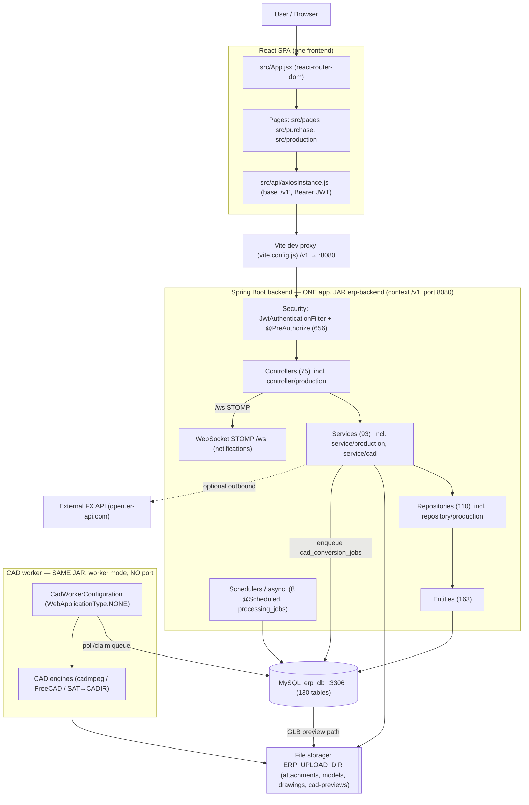

# ERP Architecture Classification

> **Read-only investigation.** No application code, schema, configuration, dependency or Git state
> was modified. The only file created is this report.
>
> **Repository:** `C:\Users\Mahes\Desktop\Sri\erp-react`
> **Date:** 2026-10-13
> **Evidence tags:** **[VERIFIED]** = confirmed by a command/file in this session; **[INFERRED]** =
> reasoned from evidence; **[NOT VERIFIED]** = could not be confirmed safely.

---

## 1. Final Classification

## ➤ **MODULAR MONOLITH** (with a strongly *layered* Java implementation)

- **Primary:** **Modular Monolith** — one deployable Spring Boot backend contains every business
  module (Dashboard, CRM, CPR, Sales/Accounts, Purchase, Production, Marketing, Documents, Settings),
  sharing one MySQL database and shared infrastructure (auth, masters, numbering, files,
  notifications).
- **Secondary description:** *a layered monolith with partial modularization*. The Java source is
  organized primarily by **technical layer** (`controller`, `service`, `repository`, `entity`, `dto`)
  rather than by domain package. Only **Production** and **CAD** have real domain sub-packages; Sales,
  Purchase, CRM and Marketing are separated by **naming conventions + URL prefixes**, not enforced
  package boundaries. So module boundaries are **real at the functional/route level** and
  **partial at the code-structure level**.
- **Not** a Distributed Monolith and **not** Microservices — see §2.

**Direct answer to the question:** *"Is my existing ERP a Modular Monolith, and what evidence proves
it?"* — **Yes, it is a modular monolith.** The proof is: exactly **one** deployable backend artifact
(one Maven project, one JAR, one `@SpringBootApplication` web entry point) that loads **all** modules
in one process, talking to **one** shared MySQL database, while the modules are functionally separate
(distinct controllers/services/repositories/entities, route prefixes and frontend areas) with only
**narrow** cross-module code coupling (Sections 7–9). It is **not** a set of independently deployable
services, so it is not microservices and not a distributed monolith.

---

## 2. Why This Classification (category-by-category)

### A. Traditional Monolith — characteristics PRESENT but insufficient alone
A single deployable application contains the business modules. **Present:** one Maven project, one
JAR, one web entry point. But calling it a *traditional* monolith would understate the functional
separation that genuinely exists (distinct modules, dedicated controllers/services, a separate CAD
domain package, self-contained frontend module folders). **Verdict:**

### B. Modular Monolith — characteristics PRESENT → primary classification ✅
- **One deployable backend** containing logically separated modules. **[VERIFIED]**
- **Internal module boundaries** exist as functional areas with their own controllers, services,
  repositories and entities (e.g. `PurchaseRequisitionController/Service/Repository`,
  `CprController/Service/Repository`). **[VERIFIED]**
- **Shared infrastructure and shared database** (auth, master data, numbering, files, notifications,
  one MySQL). **[VERIFIED]**
- **Module isolation is meaningful but not enforced by the compiler** — the layer-based packages mean
  any service *could* import any other service/entity; the only real domain sub-packages are
  `controller/production`, `service/production`, `repository/production`, `entity/production`,
  `dto/production`, plus `service/cad` and `cad`. **[VERIFIED]**

### C. Distributed Monolith — characteristics ABSENT
A distributed monolith requires multiple independently running services that stay tightly coupled
through deployment or shared data. Here there is **no second business service** — only one web
application plus a CAD *worker process* of the **same artifact** that shares the database by design
(not by accident). There is no inter-service HTTP call, no service registry, no cross-service
contract to keep in lock-step. **Verdict: ABSENT.**

### D. Microservices — characteristics ABSENT
- No independently deployable business services (Sales/Purchase/Production are **not** separate
  runtimes). **[VERIFIED]**
- No service-per-module data ownership — **one shared MySQL** with cross-module foreign keys.
  **[VERIFIED]**
- No inter-service communication contracts (no REST calls between modules; modules call each other
  in-process). **[VERIFIED]**
- The only genuinely separate runtime is the CAD worker, which is the **same JAR** in worker mode
  (`WebApplicationType.NONE`, no port) — a process, not a service. **[VERIFIED]**

> Important: the large counts (75 controllers, 93 services, 163 entities, 110 repositories, 656
> `@PreAuthorize`, 130 tables, dozens of frontend routes) do **not** make this microservices. They
> indicate a large, feature-rich **modular monolith**.

---

## 3. Actual Backend Applications and Deployment Units

| Component | Technology | Entry point | Port / process | Independently deployable? | Evidence |
|---|---|---|---|---|---|
| **ERP backend (the only business app)** | Spring Boot 3.4.13 / Java 21, one Maven module | `com.vishatech.erp.ErpApplication` (`@SpringBootApplication`) | **8080**, context `/v1`, HTTP process | **Yes — this is the single deployable backend artifact** | `erp-backend/pom.xml` `<mainClass>com.vishatech.erp.ErpApplication</mainClass>`; `application.properties:14-16` |
| **CAD conversion worker** | Same artifact; `com.vishatech.cadworker.CadWorkerConfiguration` (`@SpringBootApplication`, `WebApplicationType.NONE`) | `CadWorkerApplication.main` via `--erp.cad.worker.mode=true` / `ERP_CAD_WORKER_MODE=true` | **No port**; separate **process** | **No** — it is the *same JAR*, launched in a second mode | `ErpApplication.java:12-20`; `CadWorkerConfiguration.java:33-56`; `CadWorkerApplication.java` |
| **Frontend SPA** | React 19 + Vite 8 | `index.html` → `src/main.jsx` → `src/App.jsx` | Dev server **5173/5174**; static build `dist/` | Yes (independently built/deployed), but it is a **frontend**, not a backend service | `package.json` scripts; `vite.config.js` |
| **MySQL** | MySQL | — | **3306** | Infrastructure, not an app | `application.properties:27` |

**How many backend applications?** **One** business backend application. It has **two run modes**
(ERP web, and CAD worker) from **one artifact**, so:

- **Deployable backend artifacts = 1** (the `erp-backend` JAR).
- **Backend web process = 1** (Spring MVC, port 8080).
- **Optional worker processes = up to 1** (CAD worker, no port) — a *process role* of the same JAR,
  not a second application and not an independent deployment artifact.

**Not independent services:** Sales, Purchase, Production, CRM, Accounts, Engineering Design,
Marketing, Dashboard and Settings are **internal modules inside the single Spring Boot application**,
not separate backends. **[VERIFIED]**

---

## 4. Frontend → Backend → Database Architecture Flow

**Actual, verified flow** (adapted from the example, not copied):

```
Browser
  → React SPA (src/App.jsx routes; module pages under src/pages, src/purchase, src/production)
  → API client: src/api/axiosInstance.js   (baseURL = VITE_API_URL || '/v1'; Bearer JWT interceptor)
  → Vite dev proxy: vite.config.js  '/v1' → ERP_PROXY_TARGET (default http://localhost:8080)
  → Spring Boot backend  (context path /v1, port 8080)
      → Security filter chain (JwtAuthenticationFilter → @PreAuthorize)
      → Controller  (e.g. CprController  @RequestMapping("/cprs"))
      → Service     (e.g. CprService, @Transactional)
      → Repository  (e.g. CprRepository, Spring Data JPA)
      → Hibernate/JPA → MySQL  (schema erp_db, ddl-auto=validate)
  ← ApiResponse<T> envelope → Axios response interceptor → React state → render
```

Where the other concerns fit:

| Concern | Where it lives | Evidence |
|---|---|---|
| **Module-to-module calls** | In-process Java method calls (not HTTP) | Production→Sales in `service/production/ProductionOrderService.java` |
| **Authentication** | `AuthController` (`/auth/login|register|refresh|logout|me`), `JwtService`, `JwtAuthenticationFilter`, `RefreshTokenService`; token stored in `localStorage` (`src/services/tokenStorage.js`) | `SecurityConfig.java:62-85` |
| **Authorization** | `@PreAuthorize` on controllers (656 uses), roles `ADMIN/MANAGER/USER` | `@PreAuthorize` count |
| **Document storage** | `FileController` (`/files`), `FileStorageService`, `AttachmentStorageService`; files on disk under `ERP_UPLOAD_DIR`, metadata in DB | `application.properties:73`; storage services |
| **Notifications** | STOMP over WebSocket endpoint `/ws`, simple broker `/queue`,`/topic`; `NotificationController`, `NotificationScheduler` | `WebSocketConfig.java:42-51` |
| **Background processing** | `@Scheduled` (8 uses) + `ProcessingJobAsyncConfig`; durable queue tables (`processing_jobs`, `cad_conversion_jobs`) | `@Scheduled` count; config package |
| **CAD processing** | Separate worker process consumes the DB queue `cad_conversion_jobs`, writes GLB to disk | `CadWorkerConfiguration.java`; `service/cad/` |

---

## 5. Module Boundaries and Dependency Analysis

### 5.1 Java package structure (the key evidence about "boundaries")

The backend is organized **by layer**, and **only Production/CAD have domain sub-packages**:

```
com.vishatech.erp/
├─ controller/            (75 controllers; controller/production/ has the only domain sub-package)
├─ service/               (93 services; service/production/ and service/cad/ are the only domain sub-packages)
├─ repository/            (110 repositories; repository/production/ only)
├─ entity/                (163 entities; entity/production/ only)
├─ dto/                   (dto/production/ only)
├─ security/  config/  exception/  util/
com.vishatech.cadworker/  (worker entry point + store/scheduler)
```

**[VERIFIED]** Purchase (10 controllers, 13 services), Sales/Quotation/Invoice/etc. (14 services), CRM
and Marketing are **flat files within the layer packages** distinguished by name — there is no
`purchase/`, `sales/`, `crm/` package. So module boundaries exist **functionally**, and are
**architecturally best-established for Production and CAD**.

### 5.2 Cross-module dependency evidence

| Relationship | Evidence | Type | Strength |
|---|---|---|---|
| **Sales → Production** | No entity/service/repository references found | — | **None [VERIFIED]** |
| **Production → Sales** | `service/production/ProductionOrderService.java` imports `entity.SalesOrder`, `repository.SalesOrderRepository`, `repository.SalesAttachmentRepository`, `dto.SalesAttachmentResponse` (lines ~5,8,43,105,699-711) | Business + Database (reads Sales tables) | **Narrow — one service [VERIFIED]** |
| **Production → Sales (UI)** | `src/production/utils/salesOrderReadModel.js` — reads `GET /sales-orders/options` and `GET /sales-orders/{id}` | UI/API | Loose (already HTTP) **[VERIFIED]** |
| **Purchase → shared infra** | `entity.User`/`UserRepository`, `Notification`/`NotificationRepository`, `util.PurchaseNumbering`, `util.PurchaseTotals`, `util.AuditContext`; production `AuditModule`/`AuditAction` **enums only** | Shared-infrastructure + Database | **No Sales/Production data coupling [VERIFIED]** |
| **Production → shared infra** | Uses `FileStorageService`, `service/cad/CadConversionJobService`, `repository.production.*`, `util.UploadStreams`, `AppSettingRepository` | Shared + internal | Moderate **[VERIFIED]** |
| **Production integration** | `service/production/IntegrationService.java` uses raw `jakarta.persistence.EntityManager` | Database (raw JPA) | Cross-cutting, exact queries **[INFERRED]** |
| **Everything → shared** | 28 service classes reference `MasterValue`/`Notification`/`Attachment`/`DocumentRepository`; 23 entities reference `Customer`; shared numbering utilities used across modules | Shared-infrastructure + Database | High (by design) **[VERIFIED]** |
| **CRM → Documents/Notifications** | `LeadController/Service`, `FollowUpService` + `DocumentRepositoryService`, `NotificationService` | Shared-infrastructure | Moderate **[VERIFIED]** |

**Interpretation [INFERRED]:** business coupling between the big modules is **lighter than typical** —
there is no Sales↔Production cycle, Production's read of Sales is confined to one service, and
Purchase is essentially self-contained against shared infrastructure. The dominant coupling is
**shared infrastructure and one shared database**, which is exactly the classic modular-monolith
dependency profile.

---

## 6. Shared Database and Infrastructure

| Aspect | Finding | Evidence |
|---|---|---|
| Databases | **Exactly one** MySQL server, schema `erp_db` | `application.properties:27` (`jdbc:mysql://localhost:3306/erp_db`) |
| Schema mode | `ddl-auto=${ERP_DDL_AUTO:validate}` — no implicit DDL | `application.properties:36` |
| Schema size | **130 tables** in `erp-backend/erp_db_schema_latest.sql` | grep count |
| Cross-module FKs | Yes (e.g. `cpr→quotation→sales_order`, `sales_order→production_order`, `contacts→leads/customers`) | schema/entities |
| Shared tables | `users`, `refresh_tokens`, `master_values`, `app_settings`, `auto_number_sequences`, `notifications`, `document_repository`, `document_versions`, `attachment_storage_usage`, `audit_logs` | schema |
| Shared auth | One `SecurityConfig` + JWT + refresh tokens for the whole app | `SecurityConfig.java` |
| Shared numbering | `auto_number_sequences` + `util/PurchaseNumbering` | util/config |
| Shared files | One storage root `ERP_UPLOAD_DIR` (attachments, models, drawings, CAD previews, job staging) | `application.properties:73-90` |
| Transactions | **Local DB transactions only** — 608 `@Transactional` in one JVM/DataSource; **no distributed transactions** | `@Transactional` count |

**Contacts schema note:** the `contacts` table is **absent** from `erp_db_schema_latest.sql`
(0 matches) and is defined only in `erp-backend/docs/contacts_migration.sql` (now tracked). Whether it
exists in the **live** database is **NOT VERIFIED** (no `mysql` client / Python MySQL driver
available, and no writes permitted). Under `ddl-auto=validate` this is a boot risk until the table
exists. **[VERIFIED from files; live state NOT VERIFIED]**

---

## 7. Mermaid — Current Architecture (as implemented)



**Legend:** solid arrows = HTTP/REST; `Ctrl→Svc→Repo` = internal Java method calls within one JVM;
`Repo→DB` = JPA/SQL; `→ WS` = WebSocket; `→ FS` = file system; `Sched`/`CW` = background execution.

**No proposed microservices are drawn** — Sales/Purchase/Production are **inside** the single backend
box because that is how they exist today.

---

## 8. Verified Facts, Inferences, Unverified Items

**Verified**
- One Maven project; one JAR; default main class `com.vishatech.erp.ErpApplication`; context `/v1`, port 8080. **[VERIFIED]**
- A second `@SpringBootApplication` (`CadWorkerConfiguration`) runs in the **same JAR** as a no-port worker process. **[VERIFIED]**
- 75 controllers, 93 services, 163 entities, 110 repositories, 656 `@PreAuthorize`, 608 `@Transactional`, 8 `@Scheduled`. **[VERIFIED]**
- One MySQL `erp_db` (130 tables), `ddl-auto=validate`. **[VERIFIED]**
- Only Production/CAD have domain sub-packages; other modules are layer-flat with naming conventions. **[VERIFIED]**
- No Sales→Production code dependency; Production→Sales limited to one service; Purchase decoupled from Sales/Production data. **[VERIFIED]**
- Working tree **clean** at commit `93a76c3` ("Upload complete ERP source code"), branch `main`; remote `origin` = `https://github.com/Mahes257/Beforezip.git`. **[VERIFIED]**
- Gates re-run this session: `./mvnw verify` → **BUILD SUCCESS, 476 tests, 0 failures**; `npm run build` → **PASS**; `npm run lint` → **FAIL (863 problems: 779 errors, 84 warnings)**; runtime MySQL :3306, backend :8080 `{"status":"UP"}`, frontend :5173 HTTP 200. **[VERIFIED]**
- CI (`.github/workflows/ci.yml`) runs frontend build + backend `./mvnw verify` only — **it does not run frontend lint or tests**. **[VERIFIED]**

**Inferred**
- Module coupling profile is "loose business coupling, heavy shared-infrastructure coupling" (from import analysis). **[INFERRED]**
- `IntegrationService`'s raw `EntityManager` may read other modules' tables. **[INFERRED]**
- The two frontend contract-test failures are stale-source assertions, not runtime defects. **[INFERRED]**

**Not verified**
- Live DB schema (incl. whether `contacts` exists) — no MySQL client/driver; writes forbidden. **[NOT VERIFIED]**
- End-to-end behaviour of authenticated workflows (CRM, Sales, Purchase, Production, CAD). **[NOT VERIFIED]**
- Exact behavior of scheduler duplication if multiple app instances run (schedulers exist; runtime multiplicity not exercised). **[NOT VERIFIED]**

---

## 9. Strengths, Limitations, and Recommendation

**Strengths**
- **Simple to build, run and debug:** one backend jar, one frontend, one database.
- **Strong shared foundations:** one auth model, one numbering service, one file store, one document
  repository, one notification channel — no duplication across modules.
- **Meaningful functional separation already exists** (dedicated controllers/services/repositories;
  Production/CAD have real packages), so the code is not a "big ball of mud".
- **Good test volume** at the backend (476 tests, green) and clear local transaction handling.

**Limitations / risks**
- **Layer-first packaging** means module boundaries are conventions, not enforced — nothing stops a
  service importing another module's repository/entity.
- **One shared database with cross-module FKs** couples modules at the data level; schema risk is real
  (the `contacts` table is not in the checked-in schema).
- **Weak frontend quality gate:** lint fails (863 problems) and CI does not run lint/tests.
- **No end-to-end verification** of the major workflows.
- **Single-instance assumptions** in schedulers/queue would need attention before any horizontal scale.

**Recommendation (no implementation here):** **retain and improve the current modular monolith.**
Do not convert to microservices now. Concretely (future work, not performed): freeze/monitor the now-clean
baseline, make module boundaries explicit (domain packages and/or facade interfaces so cross-module
calls do not reach into each other's repositories), close the `contacts` schema gap, green the
frontend lint/test gate, and add end-to-end workflow tests. These steps increase independence **inside**
the single deployable unit without paying the distributed-system cost.

---

## 10. Final Conclusion

**Is the ERP already monolithic?** Yes — one deployable backend application holds all business modules.

**Is it a modular monolith?** **Yes.** It is a modular monolith with a layered Java structure.

**Why classified that way?**
- **One** deployable backend artifact (one Maven project, one JAR, `mainClass=ErpApplication`) loads
  Dashboard, Marketing, CRM, CPR, Sales/Accounts, Purchase, Production, Documents, Settings and shared
  infrastructure in **one process** on port 8080 with context `/v1`. **[VERIFIED]**
- Modules are functionally separated (their own controllers/services/repositories/entities, route
  prefixes and frontend areas) but **share one MySQL** and shared infrastructure. **[VERIFIED]**
- The only separate runtime is a **CAD worker of the same JAR** (no port) — a process, not a service.
  **[VERIFIED]**

**How many actual backend deployment units exist?** **One** deployable backend artifact; **one** web
application process (port 8080); an **optional second process** (CAD worker, no port) from the **same
artifact**; plus one frontend SPA and one MySQL server.

**How do the parts interact?** React (routed, Axios `/v1`) → Vite proxy → Spring Boot security →
controller → service (in-process module calls, `@Transactional`) → repository → MySQL; files on the
local storage root; notifications over STOMP `/ws`; background work via `@Scheduled`/async queues; and
the CAD worker claiming jobs from the same database.

**Implemented vs planned** [VERIFIED]: all listed modules and the CAD worker are **implemented**; the
Sales/Purchase/Production **separate backends are only proposed** and do **not** exist (they are
internal modules today).

**Continue or redesign?** **Continue with the existing modular monolith and improve its internal
boundaries.** Microservices would add distributed-transaction, data-ownership and operational cost
without a demonstrated need, on a single physical server, for a codebase whose business modules are
already only lightly coupled.

---

*End of report. Read-only; the only artifact created is this file.*
