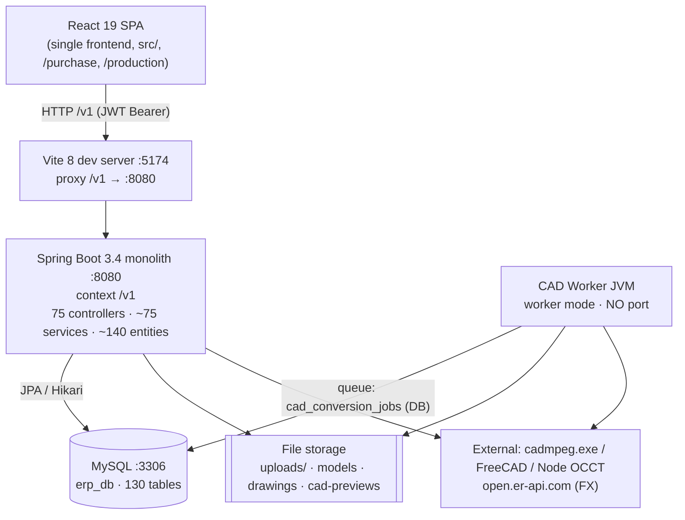
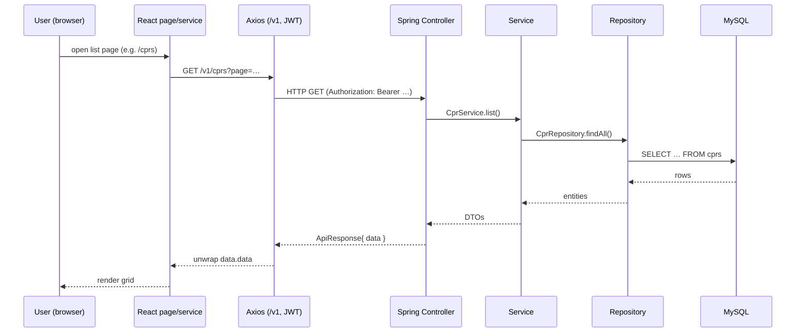
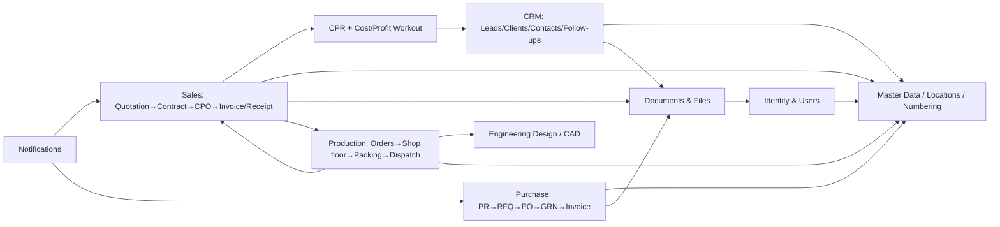
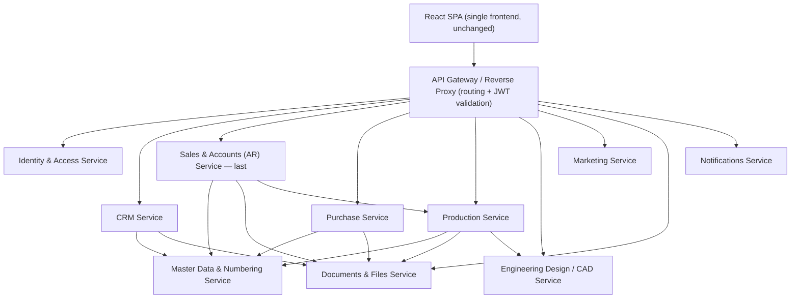

# Vishak ERP — Current-State Technical Audit & System Summary

> **Scope:** READ-ONLY analysis and documentation of the *existing* application as it stands
> before any microservices migration. No source code, schema, configuration, port or Git state
> was changed while producing this report.
>
> **Audit date:** 2026-10-13
> **Method:** direct inspection of the working tree, Git metadata, source files, configuration,
> build files, SQL scripts and live OS/network state. Every factual claim is backed by a file
> path or a command output. Anything that could not be confirmed is marked **NOT VERIFIED**.

---

## 1. Executive Summary

The "ERP" is **one React single-page application plus one Spring Boot backend** — a classic
**modular monolith**, not a set of microservices.

- **Frontend:** React 19.2 + Vite 8.2 + Tailwind 4.3 SPA in `erp-react/`. ~1,146 source files.
  Talks to the backend over a single Axios instance whose base URL is `/v1`, proxied by the Vite
  dev server to `http://localhost:8080`.
- **Backend:** a **single** Spring Boot 3.4.13 application on Java 21 (`erp-backend/`), Maven,
  serving everything under servlet context path `/v1` on **port 8080**. It contains **75 REST
  controllers**, ~75 services, ~140 entities, ~89 repositories and 218 DTOs in one deployable jar.
  Modules are separated by **Java package/folder conventions and route prefixes**, not by process
  or database boundary.
- **Second runtime process (not a service):** an **isolated CAD conversion worker** — the *same
  jar* launched with `--erp.cad.worker.mode=true`. It binds **no port** and coordinates with the
  main app only through the shared database queue (`cad_conversion_jobs`).
- **Database:** **one shared MySQL instance** on port 3306, database `erp_db`, **130 tables**
  (per `erp-backend/erp_db_schema_latest.sql`). Hibernate `ddl-auto=validate` (no implicit schema
  changes).
- **Auth:** stateless JWT (Bearer in `Authorization`) + rotating refresh tokens, three roles
  (`ADMIN`, `MANAGER`, `USER`) and 656 method-level `@PreAuthorize` checks.
- **Live state observed:** MySQL (3306), the Spring Boot ERP (8080) and a second JVM are running;
  the Vite dev server (5174) is **not** currently listening.

**Bottom line for a migration:** the code is organized so that module boundaries (CRM, Sales,
Purchase, Production, Accounts, Marketing, Documents) are *visible in the package/route layout*,
which is promising. But the modules share **one database, one security model, one file-storage
root and dense cross-module FKs**, so extraction must start with the module that has the fewest
inbound dependencies — see §14/§15.

### Quick facts

| Item | Value |
|---|---|
| Project root (workspace) | `C:\Users\Mahes\Desktop\Sri` |
| Git repository root | `C:\Users\Mahes\Desktop\Sri\erp-react` |
| Branch | `main` |
| Remote | `origin` → `https://github.com/Mahes257/vishak-erp.git` (no credentials read/printed) |
| Working tree | **dirty** — 133 modified, 63 untracked, 1 deleted (197 files) |
| Commits | 9 (first `d7c31fb Initial ERP project`, latest `61859bf` 2026-10-07) |
| Nested repositories | **none** (single `.git`) |
| Frontend root | `erp-react/` |
| Backend root | `erp-react/erp-backend/` |
| Backend framework | Spring Boot 3.4.13, Java 21, Maven |
| Frontend framework | React 19.2, Vite 8.2, Tailwind 4.3, react-router-dom 7.18 |
| Database | MySQL, DB `erp_db`, 130 tables, port 3306 |
| Backend port | 8080 (context path `/v1`) |
| Frontend dev port | 5174 (script) / Vite default 5173 if run directly |

---

## 2. Project and Repository Details

### 2.1 Absolute paths

- Workspace / task root: `C:\Users\Mahes\Desktop\Sri` — **is not itself a Git repository**
  (`git rev-parse` → *not a git repository*).
- Actual Git repository: `C:\Users\Mahes\Desktop\Sri\erp-react` (`git rev-parse --show-toplevel`).
- Backend subproject: `C:\Users\Mahes\Desktop\Sri\erp-react\erp-backend` (a plain directory inside
  the same repo — **not** a separate Git repo or Maven multi-module reactor).

Top-level contents of the workspace (`Sri/`):

```
Sri/
├─ erp-react/          ← the application AND the Git repository
├─ erp_db_schema.sql   ← older full DB schema export (171 KB, Sep 19)
├─ tmp/                ← scratch logs & audit scripts (NOT part of the app; untracked)
├─ .freebuff/          ← agent/tooling state
├─ .github/modernize/  ← VS Code "modernize" hook scripts (not app CI)
└─ .vscode/settings.json
```

### 2.2 Git audit (repository `erp-react`)

- **Current branch:** `main`.
- **Remotes:** `origin` = `https://github.com/Mahes257/vishak-erp.git` (fetch + push). URL is a
  public HTTPS URL; **no credentials or tokens were read or printed.**
- **Working-tree status (porcelain summary):**

  | State | Count |
  |---|---|
  | Modified (` M`) | 133 |
  | Untracked (`??`) | 63 |
  | Deleted (` D`) | 1 |
  | **Total** | **197** |

- **Diff size:** `134 files changed, 7914 insertions(+), 3030 deletions(-)` (tracked changes only).
- **Notable deletion:** `erp-backend/src/main/java/com/vishatech/erp/controller/CrmController.java`
  is deleted in the working tree (uncommitted). CRM endpoints now come from other controllers
  (see §5/§9 — this must be resolved before any migration).
- **Untracked additions of note:** a whole new `Contact` slice
  (`ContactController`, `ContactService`, `ContactRepository`, `Contact` entity + DTOs),
  `SatAcisConversionEngine`, several new tests, `src/components/DocumentSelection/`,
  `src/pages/AdvancedSettings.jsx`, `src/pages/crm/ContactFormPage.jsx`,
  `src/pages/crm/ContactViewPage.jsx`, new deployment docs, and `erp-backend/tmp-run-8099.sh`.
- **Commit history (newest first):**

  ```
  61859bf Update lead form inputs
  a52fd32 Update Production module tables and sticky layout
  a53a075 Fix Marketing workflows, global scroll, and production model upload
  cc79695 Complete Purchase module fixes and workflow improvements
  82a8992 Fix ERP workflows and enhance CAD support
  60934ea Integrate ERP module updates and fixes
  a52856a Remove legacy CAD conversion pipeline
  1443563 Fix backend CI test failures
  d7c31fb Initial ERP project
  ```
  All commits appear to be authored directly on `main`; no merge commits / PR numbers in the log.

- **Monorepo?** Not a monorepo in the tooling sense. It is a **single repository** containing a
  frontend app at the root and a backend at `erp-backend/`. There are **no nested `.git`
  directories** other than `erp-react/.git` (verified with `find -name .git`).
- **Duplicate / archived versions:** none found inside the repo. The scratch folder
  `Sri/tmp/` and `Sr/erp-react/tmp/`, `.tmp-clean/`, `dist/`, `target/` contain generated logs
  and build output only (not alternative projects).

### 2.3 Preservation note

All uncommitted work was left exactly as found. This audit performed **no** `git add`, commit,
reset, clean, checkout, stash, delete or move.

---

## 3. Actual Folder and File Structure

> Actual structure found (abridged; generated `node_modules`, `target`, `dist` collapsed).
> This is the real layout — it was **not** rearranged for the report.

```
erp-react/                         ← Git repo root + frontend root
├─ index.html                      ← Vite HTML entry (<script src="/src/main.jsx">)
├─ package.json / package-lock.json
├─ vite.config.js                  ← dev proxy /v1 → ERP_PROXY_TARGET (default localhost:8080)
├─ eslint.config.js
├─ .env / .env.example / .env.ui-test   ← frontend env (VITE_API_URL, ERP_PROXY_TARGET, …)
├─ start-all.sh / start-all.bat / start-dev.bat   ← full-stack startup scripts
├─ README.md / PROJECT_REPORT.md / SECURITY_AUDIT.md / *_AUDIT*.md / E2E_TEST_REPORT.md  ← existing docs
├─ src/                            ← FRONTEND SOURCE (1,146 files)
│  ├─ main.jsx / App.jsx           ← entry component + full route table
│  ├─ api/axiosInstance.js         ← the single Axios instance (/v1)
│  ├─ services/                    ← 40+ API client services (lead, cpr, sales, …)
│  ├─ pages/                       ← route pages (dashboard, crm, cpr, sales, marketing, settings)
│  ├─ components/                  ← shared + module UI components (CRM, Sales, Layout, Common…)
│  ├─ hooks/ config/ utils/ constants/ data/ styles/ assets/
│  ├─ purchase/                    ← self-contained Purchase module (routes, pages, services, api, validation)
│  └─ production/                  ← self-contained Production module (routes, pages, services, context, modelviewer)
├─ tests/                          ← 16 frontend test files (node:test style)
├─ scripts/                        ← 170+ CDP/audit/verification .cjs/.mjs scripts (dev tooling)
├─ tools/cad/sat/step-to-cadir.cjs ← OpenCascade STEP→CADIR helper used by the CAD worker
├─ public/                         ← favicon + static assets
├─ uploads/                        ← runtime file storage (not source)
├─ dist/                           ← Vite production build output (generated)
├─ .github/workflows/ci.yml        ← CI: frontend build + backend ./mvnw verify
├─ .github/modernize/              ← tooling hooks (not app CI)
└─ erp-backend/                    ← BACKEND ROOT (single Spring Boot app)
   ├─ pom.xml                      ← Maven build (Spring Boot 3.4.13 parent, Java 21)
   ├─ mvnw / mvnw.cmd / .mvn/
   ├─ .env / .env.example          ← backend secrets/URLs (ERP_DATABASE_*, ERP_JWT_SECRET, …)
   ├─ erp_db_backup_20260813_*.sql ← DB backups (2 files)
   ├─ erp_db_schema_latest.sql     ← current schema (130 tables)
   ├─ tmp-run-8099.sh              ← ad-hoc run on port 8099 (untracked)
   ├─ docs/                        ← migration/deploy SQL + markdown docs
   ├─ uploads/                     ← runtime storage (drawings, models, cad-previews, processing-jobs)
   ├─ target/                      ← Maven build output (generated)
   └─ src/
      ├─ main/java/com/vishatech/erp/
      │  ├─ ErpApplication.java    ← main entry (also switches to worker mode)
      │  ├─ controller/            ← 57 REST controllers (+ production/ with 18 more)
      │  ├─ service/               ← ~75 services (+ production/, cad/)
      │  ├─ repository/            ← ~89 Spring Data repositories
      │  ├─ entity/                ← ~140 JPA entities (+ production/)
      │  ├─ dto/                   ← 218 request/response DTOs
      │  ├─ security/              ← JWT filter, roles/permissions, rate limiting, handlers
      │  ├─ config/                ← SecurityConfig, WebSocket, schedulers, seeders, metrics
      │  ├─ exception/             ← GlobalExceptionHandler + typed exceptions
      │  ├─ util/                  ← helpers (+ production/)
      │  └─ cad/                   ← CAD conversion engines/registry
      ├─ main/resources/           ← application.properties, logback-spring.xml, static
      └─ test/                     ← 77 test classes + application.properties (H2 profile)
```

**Explanation of the main areas**

| Area | Path | Purpose |
|---|---|---|
| Frontend source | `erp-react/src` | All UI, routing, API clients, utilities |
| Purchase module | `erp-react/src/purchase` | Self-contained (own routes/pages/services/styles/api) |
| Production module | `erp-react/src/production` | Self-contained (own routes/pages/services/context/model viewer) |
| Backend source | `erp-react/erp-backend/src/main/java/com/vishatech/erp` | The ERP monolith |
| Backend config | `erp-backend/src/main/resources/application.properties` | Ports, DB, JWT, storage, jobs, CORS |
| Schema / migrations | `erp-backend/docs/*.sql`, `erp-backend/erp_db_schema_latest.sql`, workspace `erp_db_schema.sql` | Schema + targeted migrations |
| Startup scripts | `erp-react/start-all.sh`, `start-all.bat`, `start-dev.bat` | Bring up MySQL/backend/CAD worker/frontend |
| CI | `erp-react/.github/workflows/ci.yml` | Frontend build + backend `./mvnw verify` |
| Tests | `erp-react/tests/*.test.js`, `erp-backend/src/test/java/**` | Frontend + backend test suites |
| Runtime storage | `erp-react/uploads`, `erp-backend/uploads` | Uploaded attachments, CAD models/drawings/previews |
| Generated/cache | `node_modules`, `dist`, `target`, `*.log`, `tmp` | Not source (safe to ignore) |

**Build / dependency manifests:** `erp-react/package.json` (+lock), `erp-backend/pom.xml`,
`erp-backend/.mvn/wrapper/maven-wrapper.properties`.

---

## 4. Frontend Architecture

**Framework / versions** (from `package.json`):

| Package | Version | Role |
|---|---|---|
| react / react-dom | ^19.2.8 | UI runtime |
| react-router-dom | ^7.18.2 | Routing |
| vite | ^8.2.0 | Build/dev server (Node ≥ 20.19 / 22.12) |
| @vitejs/plugin-react | ^6.0.4 | React integration |
| tailwindcss / @tailwindcss/vite | ^4.3.3 | Styling |
| axios | ^1.19.0 | HTTP client |
| react-hook-form + @hookform/resolvers + zod | ^7 / ^5 / ^3 | Forms + validation |
| @stomp/stompjs | ^7.3.0 | WebSocket notifications |
| jspdf, jspdf-autotable, html2canvas-pro, pdf-lib, xlsx, jszip | — | PDF/Excel/print/bulk export |
| three, occt-import-js, @stomp… | — | 3D CAD model viewer |
| leaflet, react-leaflet | — | Marketing maps |

**Root directories and entry points**

- Entry HTML: `erp-react/index.html` → `<script type="module" src="/src/main.jsx">`.
- Entry JS: `src/main.jsx` mounts `<App/>` (React `<StrictMode>` deliberately **removed** to avoid
  double API calls in dev — documented inline).
- Routing: `src/App.jsx`. `BrowserRouter` + `Routes`; the authenticated tree is wrapped in
  `ProtectedRoute` → `AppLayout`. Almost all pages are `React.lazy()` with a `Suspense` boundary.
  Purchase and Production are mounted as **single lazy sub-route trees**:
  `/purchase/*` → `src/purchase/routes/purchaseRoutes.jsx`,
  `/production/*` → `src/production/routes/productionRoutes.jsx`.

**Navigation / layouts**

- `src/components/Layout/AppLayout.jsx` — app shell (sidebar, topbar, theme toggle, notification
  bell, pending-approvals badge, page titles). The primary nav tree is rendered by
  `src/components/Layout/SalesNav.jsx` (groups: **Marketing, Sales, Purchase, Production**).
- `src/components/Layout/ModuleHubLayout.jsx` — shared hub layout for module landing pages
  (`/crm`, `/sales`, `/marketing`, `/cprs`).
- `src/purchase/layouts/PurchaseLayout.jsx` — Purchase module shell.

**Navigation parents → children (from `SalesNav.jsx`, evidence line-referenced in source)**

- **Marketing**: Offline Marketing (`/marketing`), Marketing Settings (`/marketing/settings`) —
  plus child pages reached from the hub (Q-Forms, Travel Planners, Expenses, Dashboard, Calendar,
  Follow-ups, Visits, Map).
- **Sales**: Sales Dashboard; **CRM** (Leads/Clients/Contacts/Follow-ups, `/crm`); **CPR**
  (`/cprs`, plus Cost Workout, Profit Workout, Technical Verification); **Sales Execution**
  (`/sales` hub: Quotations, Sales Contracts, Sales Orders/CPO, E-Actions, Delivery Challans,
  Proforma Invoices, Invoices, Credit Notes, Payment Receipts); Documents; Sales Reports; Sales
  Settings.
- **Purchase**: categories from `purchase/constants` (Requisition, Vendors, RFQ & Quotations,
  Orders, Logistics, Invoices, Reports, Settings, Documents).
- **Production**: Dashboard, Orders, Technical Verification, Drawings, Models, Casting,
  Fabrication, Machine Shop, Assembly, Quality, Packing, Dispatch, Reports, Settings.

**API layer**

- `src/api/axiosInstance.js` — the **single** Axios instance. `baseURL = VITE_API_URL || '/v1'`,
  30 s default timeout (30 min for multipart/blob). Request interceptor attaches the Bearer JWT and
  proactively refreshes when the token is expired/expiring (60 s buffer). Response interceptor
  performs a single-flight silent refresh on 401 and replays the request; on failure it clears the
  session and redirects to `/signin`.
- `src/services/*.js` — per-domain service modules (e.g. `leadService.js` → `/leads`,
  `cprService.js` → `/cprs`, `salesOrderService.js` = `createSalesService('sales-orders')`,
  `quotationService.js`, `invoiceService.js`, …). Most wrap `ApiResponse` (`data.data`).
- Purchase has its own service facade and base: `src/purchase/api/index.js`
  `PURCHASE_API_BASE = VITE_PURCHASE_API_BASE || '/api/purchase'` (so full path is
  `/v1/api/purchase/...`). Purchase supports **`VITE_PURCHASE_DATA_MODE`** — `local` (mock/localStorage)
  vs `api` (real backend), defaulting to `api` in `api-client.js`.
- Production has its own `src/production/services/production/*` (orders, drawings, models, casting,
  quality, packing, dispatch, reports, settings, CAD conversion).

**API proxy** (`vite.config.js`): `server.proxy['/v1'] = { target: ERP_PROXY_TARGET || 'http://localhost:8080', changeOrigin: true, ws: true }`. Same-origin design means CORS is not needed in dev.

**State management:** no Redux/Zustand. Global state uses React **Context providers** composed in
`App.jsx`: `ThemeProvider`, `ToastProvider`, `ErrorBoundary`, `ApiErrorProvider`,
`ExchangeRateProvider`, `PendingApprovalProvider`, `CurrentUserProvider`, `NotificationProvider`
(WS-driven). Production adds its own provider set (`ProductionProviders`).

**Auth handling:** `src/services/tokenStorage.js` (JWT + refresh + user in `localStorage`),
`src/services/authService.js` (login/refresh/logout), `src/components/Auth/ProtectedRoute.jsx`
(route guard based on `isAuthenticated()` = valid access token **or** refresh token present).

**Forms / validation:** `react-hook-form` + `zod` (resolvers). Purchase has a dedicated
`src/purchase/validation/*`.

**Environment variables used by the browser:** `VITE_API_URL`, `VITE_GOOGLE_MAPS_API_KEY`,
`VITE_PURCHASE_DATA_MODE`, `VITE_PURCHASE_API_BASE`, `VITE_CAD_POLL_MS` (and optional
`ERP_PROXY_TARGET` read server-side by `vite.config.js`). Actual `.env` values are git-ignored.

**File upload / download:** shared attachment util `src/utils/attachmentStorage.js` (limit mirror),
`src/utils/fileAccess.js`; document generation/printing via `src/utils/*PrintUtils.js`,
`cprExportUtils.js`, `exportService.js`, `documentRegeneration.js`.

**Build scripts:** `npm run dev` (vite), `npm run build` (vite build), `npm run lint` (eslint),
`npm run preview`. Production output → `dist/`.

**Frontend → backend communication flow (current):** Browser → `/v1/...` (same origin) →
Vite dev proxy (or reverse proxy in prod) → Spring Boot `http://localhost:8080/v1/...`.

---

## 5. Backend Applications and Architecture

### 5.1 Is it a monolith, a modular monolith, or multiple apps?

**Evidence-based conclusion: ONE Spring Boot application = a modular monolith.**
There is exactly one `@SpringBootApplication` web artifact and one `pom.xml`. The "modules" are
Java packages and URL prefixes, plus two self-contained sub-packages
(`controller/production/**`, `service/production/**`, `entity/production/**`,
`service/cad/**`). Separate packages are **not** independent deployments.

There is a **second runtime process** — the CAD worker — but it is the **same jar** running with
`--erp.cad.worker.mode=true` and it exposes **no HTTP port** (see §6/§8). That is a worker, not a
microservice.

### 5.2 Identity

| Attribute | Value |
|---|---|
| Application name | `erp-backend` (`spring.application.name`) |
| Root | `erp-react/erp-backend` |
| Language / runtime | Java 21 |
| Framework | Spring Boot 3.4.13 (Spring Framework 6.2.x, Spring Security, Data JPA, WebSocket, Actuator, Validation) |
| Build | Maven (`pom.xml`, `mvnw`), Spring Boot Maven plugin |
| Entry point | `com.vishatech.erp.ErpApplication` |
| Context path | `/v1` (`server.servlet.context-path`) |
| Port | 8080 (`server.port=${ERP_PORT:8080}`) |
| Persistence | MySQL via `mysql-connector-j`, Spring Data JPA, Hibernate `MySQLDialect` |
| DB schema mode | `spring.jpa.hibernate.ddl-auto=${ERP_DDL_AUTO:validate}` — **no implicit DDL** |
| Key libs | jjwt 0.12.6, PDFBox 2.0.32, Apache POI 5.4.1, Flying Saucer 9.3.1, Lombok, Caffeine, Micrometer/Actuator, H2 (test only) |

### 5.3 Package inventory

- **Controllers (75):** 57 at `controller/` + 18 at `controller/production/`. Route prefixes
  listed in §9.
- **Services (~75):** `service/` (e.g. `LeadService`, `CustomerService`, `CprService`,
  `QuotationService`, `SalesOrderService`, `InvoiceService`, `ProformaInvoiceService`,
  `Purchase*Service`, `Marketing*Service`, `Document*Service`, `AuthService`, `RefreshTokenService`)
  plus `service/production/**` (16) and `service/cad/**`.
- **Repositories (~89):** Spring Data JPA interfaces at `repository/` (+ `repository/production/`).
- **Entities (~140):** JPA entities at `entity/` (+ `entity/production/`).
- **DTOs (218):** `dto/` (+ `dto/production/`).
- **Security:** `security/` — `JwtAuthenticationFilter`, `JwtService`, `CustomUserDetailsService`,
  `AuthRateLimitFilter`, `RateLimiter`, `RestAuthenticationEntryPoint`,
  `RestAccessDeniedHandler`, `Permission`, `RolePermissions`, `SecurityAuditLogger`.
- **Config:** `config/` — `SecurityConfig`, `WebSocketConfig`, `StompJwtInterceptor`,
  `ApiRequestLoggingFilter`, `UploadSizeGateFilter`, `UploadStorageConfig`, seeders
  (`DataSeeder`, `MasterDataSeeder`, `ProductionDataSeeder`, `Marketing*Seeder`,
  `SalesContractTestDataSeeder`, `LocationSeeder`), schedulers (`NotificationScheduler`,
  `PurchasePaymentReminderScheduler`, `ProcessingJobRecoveryJob`,
  `AttachmentStorageReconciliationJob`), `ProcessingJobAsyncConfig`, `ErpMetrics`.
- **Exceptions:** `exception/` — `GlobalExceptionHandler` + typed exceptions
  (`ResourceNotFoundException`, `BadRequestException`, `ForbiddenException`,
  `DuplicateResourceException`, `TooManyRequestsException`).
- **Util:** numbering, totals, upload streams, master-data cache, audit context.

### 5.4 Web / security behavior

- Stateless (`SessionCreationPolicy.STATELESS`), CSRF disabled (JWT in header, no cookies).
- Public paths: `/auth/login|register|refresh|logout`, `/health`, `/error`,
  `/actuator/health|info|prometheus`, `/ws/**`. **Everything else requires authentication.**
- Method security enabled (`@EnableMethodSecurity`, 656 `@PreAuthorize`).
- CSP, `frame-options deny`, referrer policy; HSTS only when `app.security.hsts=true`.
- CORS from `app.cors.allowed-origins` (default localhost dev ports 5173–5176, 4173, 127.0.0.1).
- WebSocket: STOMP endpoint `/ws` (SockJS), in-memory broker, JWT validated on STOMP CONNECT.

### 5.5 Async / scheduled / background work

- **Processing jobs** (`processing_jobs` table + `ProcessingJobAsyncConfig`): durable queue for
  heavy parsing (e.g. Sales Contract bulk upload). Configurable concurrency/queue/retry.
- **CAD worker** (`cad_conversion_jobs` + heartbeat): separate JVM, poll-based.
- **Schedulers:** notification reminders, purchase payment reminders, processing-job recovery,
  attachment-storage reconciliation.

### 5.6 Tests

- **Backend:** 77 test classes under `erp-backend/src/test/java`. There are
  `security/*ApiTest` suites (Spring Security + MockMvc) and unit tests (`*Tests`), plus opt-in
  RestAssured live-API tests. Test profile `src/test/resources/application.properties` uses
  **in-memory H2** (MySQL mode) so CI needs no MySQL.
- **Frontend:** 16 test files in `tests/` plus inline `*.test.js` co-located in `src/` and
  `src/purchase/services`.

---

## 6. Port and Runtime Configuration Matrix

### 6.1 Configured ports (from source/config/scripts)

| Application/Service | Configured Port | Configuration File | Purpose | Evidence/Status |
|---|---|---|---|---|
| ERP backend (Spring Boot) | 8080 (default) | `erp-backend/src/main/resources/application.properties` → `server.port=${ERP_PORT:8080}` | All REST APIs under `/v1`, WS, actuator | **Configured & listening** (verified, PID 28104) |
| ERP backend — override | 8099 | `erp-backend/tmp-run-8099.sh` (`ERP_PORT=8099`) | Ad-hoc second instance for testing (untracked script) | Configured only; **not listening** |
| MySQL | 3306 (default client) | `application.properties` → `spring.datasource.url` default `jdbc:mysql://localhost:3306/erp_db` | Shared ERP database | **Configured & listening** (PID 6216 `mysqld`) |
| MySQL X Protocol | 33060 | (MySQL server default) | X protocol | Listening (side effect of MySQL) |
| Frontend dev (script) | 5174 | `start-all.sh` / `start-all.bat` (`npm run dev -- --port 5174`) | Vite dev server | Configured; **not currently listening** |
| Frontend dev (Vite default) | 5173 | Vite default (no explicit port in `vite.config.js`) | Vite dev server | Default; CORS list includes 5173–5176, 4173 |
| CAD worker | **none** | `application.properties` (`app.cad.worker.*`) | Isolated JVM, DB-queue coordinated; binds no HTTP port | **No port by design** |
| Actuator | same 8080, base path `/actuator` | `application.properties` | health/info/metrics/mappings/prometheus | Served under `/v1/actuator` |
| Vite dev proxy target | 8080 | `vite.config.js` (`ERP_PROXY_TARGET` default `http://localhost:8080`) | `/v1` → backend | Configured |

### 6.2 Ports actually listening on this machine (read-only `netstat`, at audit time)

| Port | Process | Interpretation |
|---|---|---|
| 3306 / 33060 | PID 6216 `mysqld.exe` | **MySQL running** |
| 8080 (IPv4+IPv6) | PID 28104 `java.exe` | **ERP backend running** |
| 5173 / 5174 | — | **NOT listening** (Vite dev server down) |
| 8099 | — | **NOT listening** |
| 135, 445, 5040, 5357, 49xxx, 12177, 51xxx… | Windows services | OS, unrelated |

- **Two `java.exe` processes observed** (PID 16360 and 28104). PID 28104 owns port 8080 (the ERP).
  PID 16360 is a JVM with **no listening port** — consistent with the isolated CAD worker described
  in `start-all.sh`. The `wmic` command-line inspection returned no output in this shell, so the
  exact command line of PID 16360 is **NOT VERIFIED**; identification is inferred from the
  documented startup model (worker mode binds no port).
- **Port conflicts:** none observed.
- **Documentation-only mentions:** the workspace `Sri/tmp/*` logs reference port 8099 and other
  ad-hoc ports; these are historical and not active.

---

## 7. Database Schema and Module Ownership

### 7.1 Technology and connection

- **One shared MySQL server**, database `erp_db`, on `localhost:3306`.
- Connection string (default): `jdbc:mysql://localhost:3306/erp_db?useSSL=false&allowPublicKeyRetrieval=true&serverTimezone=UTC`,
  overridable by `ERP_DATABASE_URL`. Credentials come from `ERP_DATABASE_USERNAME` /
  `ERP_DATABASE_PASSWORD` (**values not read**).
- ORM: Hibernate/JPA. `ddl-auto=validate` (schema changes are applied out-of-band via SQL scripts,
  not auto-generated). `open-in-view=false`.
- Schema sources: `erp-backend/erp_db_schema_latest.sql` (**130 tables**, newest),
  `Sri/erp_db_schema.sql` (older), and two backups in `erp-backend/`. Migration/feature SQL lives
  in `erp-backend/docs/*.sql` (e.g. `sales_execution_migration.sql`, `documents_migration.sql`,
  `cpr_migration.sql`, `processing_jobs.sql`, `production_settings.sql`, `performance_indexes.sql`,
  `mysql-app-user.sql`, `schema_baseline.sql`).

> **Read-only note:** the live database was **not** queried or dumped in this audit. Table names
> below come from the checked-in schema file, not from live metadata. Live-vs-file drift is
> **NOT VERIFIED**.

### 7.2 Tables (130) grouped by module ownership (best-effort from naming + entities)

| Module | Representative tables |
|---|---|
| **Auth / users** | `users`, `refresh_tokens` |
| **CRM** | `leads`, `lead_activities`, `lead_notes`, `lead_follow_ups`, `lead_attachments`, `lead_history`, `lead_timeline`, `followups`, `follow_up_attachments`, `followup_attachments` |
| **Clients / customers / contacts** | `customers`, `customer_contacts`, `customer_shipping_addresses`, `customer_attachments`, `clients`, `industries` |
| **CPR (Customer Purchase Request) + Cost/Profit Workout** | `cprs`, `cpr_records`, `cpr_items`, `cpr_attachments`, `cpr_comments`, `cpr_history`, `cpr_timeline`, `cpr_technical_verifications`, `cpr_technical_verification_documents`, `cost_workouts`, `cost_workout_items`, `cost_workout_categories`, `cost_workout_timeline`, `cw_master_data`, `profit_workouts`, `profit_workout_items`, `profit_workout_categories`, `profit_workout_timeline` |
| **Sales / Accounts (AR)** | `quotations`, `quotation_items`, `sales_contracts`, `sales_contract_items`, `sales_orders`, `sales_order_items`, `sales_attachments`, `sales_history`, `sales_timeline`, `delivery_challans`, `delivery_challan_items`, `proforma_invoices`, `proforma_invoice_items`, `invoices`, `invoice_items`, `payment_receipts`, `credit_notes`, `credit_note_items`, `exchange_rates` |
| **Purchase** | `purchase_requisitions`(+items, comments), `purchase_vendors`, `purchase_rfqs`(+items, followups, negotiations, evaluation_records), `purchase_quotations`, `purchase_orders`(+items), `purchase_grns`(+items), `purchase_inspections`, `purchase_inventory_movements`, `purchase_invoices`, `purchase_adjustment_notes`(+items), `purchase_shipments`, `purchase_manufacturing_jobs`, `purchase_attachments`, `purchase_timeline` |
| **Production** | `production_orders`(+items), `production_entries`, `production_trackers`, `production_machines`, `production_work_centers`, `production_status_masters`, `technical_verifications`, `tv_history`, `acknowledgements`, `approval_history`, `drawings`(+`drawing_revisions`,`drawing_history`), `models`(+`model_history`), `packing_lists`, `dispatches`, `quality_inspections`, `timeline_events`, `audit_logs` |
| **Marketing** | `marketing_leads`, `marketing_visits`, `marketing_visit_activities`, `marketing_locations`, `marketing_location_tracking`, `marketing_followups`, `marketing_expenses`(+attachments/audit/trips), `marketing_travel_plans`(+stops), `marketing_calendar`-related, `marketing_route_snapshots`, `marketing_plan_change_history`, `visit_change_history`, `questionnaire_forms`(+`qform_*`) |
| **Documents / attachments (shared)** | `document_repository`, `document_versions`, `edit_history`, `attachment_storage_usage`, `notifications` |
| **Infra / support** | `app_settings`, `master_values`, `auto_number_sequences`, `processing_jobs`, `record_revisions`, `products`, `cities`/`countries`/`districts`/`state_region`-style masters |

### 7.3 Data-ownership observations

- **Shared / cross-cutting tables:** `users`, `master_values`, `app_settings`,
  `auto_number_sequences`, `notifications`, `document_repository`/`document_versions`,
  `attachment_storage_usage`, `audit_logs`/`edit_history`/`timeline_events`, `products`,
  `exchange_rates`. These are read/written by many modules.
- **Shared master data:** location masters (`countries`, `state_region`, `districts`, `cities`),
  `master_values` — used across CRM, Sales, Purchase, Production.
- **Cross-module FKs (evidence from sales migration docs & entities):** CPR → Quotation →
  Sales Contract → Sales Order → Delivery Challan / Proforma Invoice / Invoice → Payment Receipt /
  Credit Note; Sales Order ↔ Production Order; Purchase Requisition → RFQ → PO → GRN → Purchase
  Invoice → Payment; Customer shared between CRM/Sales/Purchase.
- **Numbering** is centralized via `auto_number_sequences` (+ `util/PurchaseNumbering`,
  `auto_number_sequences` entity) — a strong shared dependency for extraction.
- **Transactions:** service-layer `@Transactional` (Spring). Because all modules share one
  DataSource, a single DB transaction can currently span multiple "modules".

---

## 8. Frontend → Backend → Database Request Flows

> Endpoints below are **verified from source**: `application.properties` sets context path `/v1`,
> so a controller mapping `/leads` is reached at `/v1/leads`; a mapping `/api/purchase/requisitions`
> is reached at `/v1/api/purchase/requisitions`. Paths for purchase are the controller prefix plus
> the method mapping (method-level paths not exhaustively verified per endpoint).

### Flow A — CRM Leads list
```
src/pages/crm/Leads.jsx
 → src/services/leadService.js   api.get('/leads', {params})
 → GET /v1/leads
 → LeadController            (@RequestMapping("/leads"), @GetMapping list)
 → LeadService
 → LeadRepository (Spring Data JPA)
 → table `leads`
 → ApiResponse<…> → axiosInstance unwraps data.data → grid renders
```

### Flow B — CPR list & workflow
```
src/pages/cpr/Cprs.jsx / CprView.jsx
 → src/services/cprService.js   api.get('/cprs'), api.post('/cprs/{id}/approve', …)
 → GET/POST /v1/cprs …
 → CprController             (@RequestMapping("/cprs"))
 → CprService
 → CprRepository (+ CprItemRepository, CprTechnicalVerificationRepository)
 → tables `cprs`, `cpr_items`, `cpr_timeline`, `cpr_history`, `cpr_technical_verifications`
```

### Flow C — Sales / CPO / E-Actions
```
src/pages/sales/SalesOrders.jsx, EActionFormPage.jsx
 → src/services/salesOrderService.js  = createSalesService('sales-orders')
 → GET/POST/PUT /v1/sales-orders …
 → SalesOrderController      (@RequestMapping("/sales-orders"))
 → SalesOrderService → SalesOrderRepository / SalesOrderEActionRepository
 → tables `sales_orders`, `sales_order_items`, `sales_timeline`, `sales_attachments`
```
(E-Action endpoints live under the same `/sales-orders` controller family; the frontend
`salesOrderEActionService.js` calls them.)

### Flow D — Purchase Requisition (separate base path)
```
src/purchase/pages/requisition/PurchaseRequisitionList.jsx
 → src/purchase/services/requisition.js → src/purchase/api/index.js
     PURCHASE_API_BASE='/api/purchase'  (axios baseURL '/v1')
 → GET /v1/api/purchase/requisitions
 → PurchaseRequisitionController (@RequestMapping("/api/purchase/requisitions"))
 → PurchaseRequisitionService → PurchaseRequisitionRepository
 → tables `purchase_requisitions`, `purchase_requisition_items`, `purchase_requisition_comments`
```

### Flow E — Production Work Order / Order
```
src/production/pages/ProductionOrders.jsx → src/production/services/production/productionOrderService.js
 → GET/POST /v1/production-orders …
 → controller/production/ProductionOrderController (@RequestMapping("/production-orders"))
 → service/production/ProductionOrderService → repository/production/ProductionOrderRepository
 → tables `production_orders`, `production_order_items`, `timeline_events`
```

### Flow F — Engineering Design / Drawings & CAD models
```
src/production/pages/DrawingsPage.jsx / ModelsPage.jsx → production/services/production/*
 → /v1/drawings, /v1/models, POST /v1/models/{id}/cad-conversion
 → controller/production/DrawingController, ModelController, CadConversionController
 → service/production/DrawingService, ModelService; service/cad/CadConversionJobService
 → tables `drawings`(+revisions/history), `models`(+history), `cad_conversion_jobs`
 → worker (separate JVM) claims the job, converts CAD → GLB, stores under uploads/cad-previews
 → viewer fetches authenticated GLB
```

### Flow G — Auth
```
src/pages/SignIn.jsx → src/services/authService.js  api.post('/auth/login')
 → POST /v1/auth/login
 → AuthController → AuthService (BCrypt) → UserRepository → table `users`
 → returns token + refreshToken → stored in localStorage (tokenStorage.js)
 → subsequent requests: Authorization: Bearer <jwt> (axiosInstance request interceptor)
```

### Observations on the request flow

- **One shared API client:** `src/api/axiosInstance.js` (plus the Purchase facade that reuses it).
- **No hardcoded backend URL in the browser code** except one dev-only constant:
  `src/purchase/services/browserBadgeValidation.js` → `const BASE = 'http://localhost:5173'`
  (flagged in §13).
- **Proxy-based routing** in dev; production is assumed same-origin (reverse proxy) — see §12.
- **Inconsistent base path convention:** most controllers use module prefixes (`/leads`, `/cprs`),
  but all Purchase controllers use an extra `/api/purchase/...` prefix → the frontend needs a
  second base (`PURCHASE_API_BASE`). This inconsistency is a migration consideration.
- **Duplicate/overlapping CRM ownership:** `CrmController.java` was **deleted** in the working tree;
  CRM endpoints are now served by `LeadController`, `CustomerController`, `ContactController`,
  `FollowUpController`. The deletion is uncommitted — resolve before freeze.
- **Missing handlers (NOT VERIFIED):** frontend modules that default to *local/mock* data
  (Purchase in `local` mode, and demo/seed helpers) can render work with **no** backend handler —
  that is by design, not necessarily a defect. A full endpoint-by-endpoint reconciliation was not
  performed.

---

## 9. API Endpoint Inventory (controller-level)

All paths are relative to context path `/v1`.

**Core / platform**
| Controller | Base mapping | Notes |
|---|---|---|
| `AuthController` | `/auth` | login, register, refresh, logout, me |
| `HealthController` | `/health` | liveness |
| `UserController` | `/users` | user management |
| `SettingsController` | `/settings` | settings |
| `GridConfigController` | `/settings/grid-configs` | grid config |
| `SalesSettingsController` / `MarketingSettingsController` | `/settings/sales`, `/settings/marketing` | module settings |
| `MasterController` | `/masters` | master data |
| `ExchangeRateController` | `/exchange-rates` | FX service |
| `FileController` | `/files` | authenticated file access |
| `DocumentRepositoryController` | `/documents` | documents module |
| `NotificationController` | `/notifications` | notifications (+ WS) |
| `ApprovalSummaryController` | `/approvals` | pending approvals |
| `EditHistoryController` | `/history` | edit history |
| `RecordRevisionController` | `/record-revisions` | revisions |
| `DashboardController` | `/dashboard` | global dashboard |
| `ProductController` | `/products` | products |
| `LocationController` | `/locations` | location masters |
| `QuestionnaireFormController` | `/marketing/q-forms` | marketing forms |

**CRM**
| Controller | Base mapping |
|---|---|
| `LeadController` | `/leads` |
| `CustomerController` | `/customers` |
| `ContactController` | `/contacts` |
| `FollowUpController` | `/followups` |
| ~~`CrmController`~~ | **deleted in working tree (uncommitted)** |

**CPR / Workouts**
| Controller | Base mapping |
|---|---|
| `CprController` | `/cprs` |
| `CprTechnicalVerificationController` | `/cpr-technical-verifications` |
| `CostWorkoutController` | `/cost-workouts` |
| `ProfitWorkoutController` | `/profit-workouts` |

**Sales / Accounts**
| Controller | Base mapping |
|---|---|
| `QuotationController` | `/quotations` |
| `SalesContractController` | `/sales-contracts` |
| `SalesOrderController` | `/sales-orders` |
| `SalesDashboardController` / `SalesReportController` | `/sales/dashboard`, `/sales/reports` |
| `DeliveryChallanController` | `/delivery-challans` |
| `ProformaInvoiceController` | `/proforma-invoices` |
| `InvoiceController` | `/invoices` |
| `PaymentReceiptController` | `/payment-receipts` |
| `CreditNoteController` | `/credit-notes` |
| `PrReferenceController` | `/pr-references` |

**Purchase** (all under `/api/purchase` inside context `/v1`)
| Controller | Base mapping |
|---|---|
| `PurchaseRequisitionController` | `/api/purchase/requisitions` |
| `PurchaseVendorController` | `/api/purchase/vendors` |
| `PurchaseRfqController` | `/api/purchase` (+ RFQ paths) |
| `PurchaseRfqFollowUpController` | `/api/purchase/rfq-follow-ups` |
| `PurchaseOrderController` | `/api/purchase/orders` |
| `PurchaseReceivingController` | `/api/purchase` (GRN/receiving) |
| `PurchaseInvoiceController` | `/api/purchase/invoices` |
| `PurchaseAdjustmentNoteController` | `/api/purchase/adjustment-notes` |
| `PurchaseDashboardController` | `/api/purchase/dashboard` |
| `PurchaseWorkQueueController` | `/api/purchase/work-queue` |

**Production** (`controller/production/`)
`/acknowledgements`, `/assemblies`, `/audit`, `/castings`, `/dispatch`, `/drawings`,
`/fabrications`, `/integration`, `/machine-shop`, `/models`, `/packing`, `/production-entries`,
`/production-kpi`, `/production-orders`, `/production/reports`, `/production/settings`,
`/technical-verifications`, plus CAD conversion on the model endpoints.

**Other module controllers**
`ExpenseTripController` `/marketing/expenses`, `MarketingController` `/marketing`,
`MarketingCalendarController` `/marketing/calendar`,
`MarketingLocationTrackingController` `/marketing/location-tracking`, `MarketingMapController`
`/marketing/map`, `MarketingVisitActivityController` `/marketing/activities`,
`TravelPlanController` `/marketing/travel-plans`, `ProductionTrackerController`
`/production-trackers`, `QualityInspectionController` `/quality-inspections`.

> **Total route annotations:** 909 `@GetMapping/@PostMapping/@PutMapping/@DeleteMapping/@PatchMapping`
> across the controllers. The per-endpoint list was **not** expanded in full here (it is large and
> derivable from the controller files); controller-level prefixes above are the reliable index.

---

## 10. Module-by-Module ERP Inventory

Status legend: **Implemented (evidence)** = controller + service + repository + entity + frontend
page + route all exist; **Partial** = some layer thin/absent or data-mode dependent;
**Unverified** = source exists but behavior not exercised in this audit.

| # | Module | Frontend route(s) / pages | Nav parent → child | Backend controller(s) | Service / Repository | Main tables | Integrations | Status | Depends on | Extractable? |
|---|---|---|---|---|---|---|---|---|---|---|
| 1 | **Dashboard** | `/dashboard` (`pages/Dashboard.jsx`) | top-level | `DashboardController` | `DashboardService` | aggregates others | — | Implemented (evidence) | all modules | No (aggregator) |
| 2 | **CRM — Leads** | `/crm`, `/leads`, `/leads/:id`, `/leads/pipeline`, `/leads/new` | Sales → CRM | `LeadController` | `LeadService`, `LeadRepository` | `leads`, `lead_*` | attachments | Implemented (evidence) | masters | Candidate (see §14) |
| 3 | **CRM — Clients** | `/clients`, `/clients/:id` | Sales → CRM | `CustomerController` | `CustomerService` | `customers`, `customer_*`, `clients` | attachments | Implemented (evidence) | masters | Candidate |
| 4 | **CRM — Contacts** | `/contacts`, `/contacts/:id` | Sales → CRM | `ContactController` (untracked/new) | `ContactService`, `ContactRepository` | `customers`/contacts | — | Partial (new/uncommitted) | CRM | with CRM |
| 5 | **CRM — Follow-ups** | `/followups`, `/followups/:id` | Sales → CRM | `FollowUpController` | `FollowUpService` | `followups`, `follow_up_attachments` | notifications | Implemented (evidence) | CRM | with CRM |
| 6 | **CPR** | `/cprs`, `/cprs/:id`, `/cprs/new`, `/cprs/reports` | Sales → CPR | `CprController`, `CprTechnicalVerificationController` | `CprService`, `CprTechnicalVerificationService` | `cprs`, `cpr_*` | PDF/print, attachments, revisions | Implemented (evidence) | CRM/Clients, masters | Candidate (central hub) |
| 7 | **Cost Workout / Profit Workout** | `/cost-workouts`, `/profit-workouts` | Sales → CPR | `CostWorkoutController`, `ProfitWorkoutController` | `CostWorkoutService`, `ProfitWorkoutService` | `cost_workout_*`, `profit_workout_*` | export | Implemented (evidence) | CPR | Candidate |
| 8 | **Sales — Quotations** | `/quotations` + many sub-routes | Sales → Sales Execution | `QuotationController` | `QuotationService` | `quotations`, `quotation_items` | PDF, FX | Implemented (evidence) | CPR, masters, FX | Candidate |
| 9 | **Sales — Contracts** | `/sales-contracts` (+bulk-upload) | Sales → Sales Execution | `SalesContractController` | `SalesContractService`, extraction services | `sales_contracts`(+items) | PDFBox/POI parsing, processing jobs | Implemented (evidence) | Quotation | Candidate |
| 10 | **Sales — CPO / Sales Orders / E-Actions** | `/sales-orders`, `/sales-orders/cpo-list`, `/sales-orders/e-actions` | Sales → Sales Execution | `SalesOrderController` | `SalesOrderService` | `sales_orders`(+items), `sales_order_*` | attachments, notifications | Implemented (evidence) | Contracts, Production | Candidate |
| 11 | **Sales — Delivery Challans** | `/delivery-challans` | Sales → Sales Execution | `DeliveryChallanController` | `DeliveryChallanService` | `delivery_challans`(+items) | PDF | Implemented (evidence) | Sales Orders | Candidate |
| 12 | **Sales — Proforma Invoices / Packing** | `/proforma-invoices`, `/packing-lists/design` | Sales → Sales Execution | `ProformaInvoiceController` | `ProformaInvoiceService` | `proforma_invoices`(+items), `packing_lists` | PDF | Implemented (evidence) | Sales Orders | Candidate |
| 13 | **Accounts — Invoices (AR)** | `/invoices` | Sales → Sales Execution | `InvoiceController` | `InvoiceService` | `invoices`(+items) | PDF, FX | Implemented (evidence) | Sales Orders | Candidate |
| 14 | **Accounts — Payment Receipts** | `/payment-receipts` | Sales → Sales Execution | `PaymentReceiptController` | `PaymentReceiptService` | `payment_receipts` | — | Implemented (evidence) | Invoices | Candidate |
| 15 | **Accounts — Credit Notes** | `/credit-notes` | Sales → Sales Execution | `CreditNoteController` | `CreditNoteService` | `credit_notes`(+items) | PDF | Implemented (evidence) | Invoices | Candidate |
| 16 | **Purchase — Requisition** | `/purchase/requisition` | Purchase → Requisition | `PurchaseRequisitionController` | `PurchaseRequisitionService` | `purchase_requisitions`(+items) | approval flow | Implemented (evidence) | masters, approvals | **First candidate** (§14) |
| 17 | **Purchase — Vendors** | `/purchase/vendors` | Purchase → Vendors | `PurchaseVendorController` | `PurchaseVendorService` | `purchase_vendors` | documents | Implemented (evidence) | masters | with Purchase |
| 18 | **Purchase — RFQ & Quotations / Negotiation / PCS** | `/purchase/rfq/*` | Purchase → RFQ & Quotations | `PurchaseRfqController`, `PurchaseRfqFollowUpController` | `PurchaseRfqService`, `PurchaseRfqEvaluationService`, `PurchaseRfqFollowUpService` | `purchase_rfqs`, `purchase_quotations`, `purchase_rfq_*` | — | Implemented (evidence) | Vendors, Requisition | with Purchase |
| 19 | **Purchase — Orders / Logistics / Invoice / Payment** | `/purchase/orders`, `/purchase/logistics/*`, `/purchase/invoices/*` | Purchase → Orders/Logistics/Invoices | `PurchaseOrderController`, `PurchaseReceivingController`, `PurchaseInvoiceController`, `PurchaseAdjustmentNoteController` | `PurchaseOrderService`, `PurchaseReceivingService`, `PurchaseInvoiceService`, `PurchaseAdjustmentNoteService` | `purchase_orders`, `purchase_grns`, `purchase_inspections`, `purchase_inventory_movements`, `purchase_invoices`, `purchase_adjustment_notes` | notifications | Implemented (evidence) | RFQ, Vendors | with Purchase |
| 20 | **Purchase — Dashboard / Work Queue / Reports / Settings** | `/purchase/dashboard`, `/purchase/work-queue`, `/purchase/reports/*`, `/purchase/settings` | Purchase → … | `PurchaseDashboardController`, `PurchaseWorkQueueController` | `PurchaseDashboardStatsService`, `PurchaseWorkQueueService` | aggregates | — | Implemented (evidence) | all Purchase | with Purchase |
| 21 | **Production — Orders / Entries / KPI** | `/production/orders`, `/production/entry`, `/production/kpi/*` | Production | `ProductionOrderController`, `ProductionEntryController`, `ProductionKpiController` | production services | `production_orders`, `production_entries`, `production_trackers` (+masters) | Sales Order integration | Implemented (evidence) | Sales Orders | Candidate |
| 22 | **Production — Technical Verification** | `/production/technical-verification` | Production | `TechnicalVerificationController` | `TechnicalVerificationService` | `technical_verifications`, `tv_history` | — | Implemented (evidence) | Orders | with Production |
| 23 | **Engineering Design — Drawings / Models / CAD** | `/production/drawings`, `/production/models`, `/model-viewer/:id` | Production | `DrawingController`, `ModelController` (+CAD) | `DrawingService`, `ModelService`, `service/cad/*` | `drawings`, `models`, `cad_conversion_jobs` | **CAD worker**, external FreeCAD/cadmpeg, occt-import-js | Implemented (evidence) | storage, worker | Separate boundary |
| 24 | **Production — Shop floor (Casting/Fabrication/Machine Shop/Assembly/Quality/Packing/Dispatch)** | `/production/casting|fabrication|machine-shop|assembly|quality|packing|dispatch` | Production | `CastingController`, `FabricationController`, `MachineShopController`, `AssemblyController`, `PackingListController`, `DispatchController`, `QualityInspectionController` | corresponding services | production + `packing_lists`, `dispatches`, `quality_inspections` | — | Implemented (evidence) | Orders/TV | with Production |
| 25 | **Production — Reports / Settings / Audit / Integration** | `/production/reports/*`, `/production/settings/*`, `/audit`, `/integration` | Production | `ProductionReportController`, `ProductionSettingsController`, `AuditController`, `IntegrationController` | report/settings/audit/integration services | `audit_logs`, masters | cross-module traceability | Implemented (evidence) | all | with Production |
| 26 | **Marketing** | `/marketing/*` (hub, q-forms, travel-planners, expenses, dashboard, calendar, follow-ups, visits, map, settings) | Marketing | `MarketingController`, `MarketingCalendarController`, `MarketingMapController`, `MarketingLocationTrackingController`, `MarketingVisitActivityController`, `TravelPlanController`, `ExpenseTripController`, `QuestionnaireFormController`, `MarketingSettingsController` | many `Marketing*Service` | `marketing_*`, `questionnaire_forms` | Google Maps, geocoding | Implemented (evidence) | masters | Candidate (self-contained) |
| 27 | **Documents (shared)** | `/documents`, `/documents/:id/preview` | Sales → Documents | `DocumentRepositoryController` | `DocumentRepositoryService`, `DocumentPermissionService`, `DocumentSettingsService` | `document_repository`, `document_versions` | storage | Implemented (evidence) | all modules | shared infra |
| 28 | **Auth / Users / Roles** | `/signin`; settings | top-level | `AuthController`, `UserController` | `AuthService`, `RefreshTokenService` | `users`, `refresh_tokens` | JWT | Implemented (evidence) | — | shared security |
| 29 | **Notifications** | `/notifications` | top-level | `NotificationController` | `NotificationService` (+ scheduler, WS) | `notifications` | WebSocket STOMP | Implemented (evidence) | all modules | shared infra |
| 30 | **Settings** | `/settings`, `/settings/financial` | top-level | `SettingsController`, module settings controllers | module settings services | `app_settings` | — | Implemented (evidence) | all | shared infra |

**Missing / unverified modules (requested targets not found as separate modules):**

- A standalone **"RFQ supplier acknowledgement"** module exists only as part of Purchase Orders
  (`SupplierAcknowledgement` page + `AcknowledgementController` in Production) — not a distinct
  service. Status: **partial/unverified**.
- **"GRN / inspection / invoice matching / payments"** exist inside Purchase (not Accounts) —
  `purchase_grns`, `purchase_inspections`, `purchase_invoices`, `ThreeWayMatching` (frontend).
- **"Vouchers"** as an accounting primitive: **not found** as a first-class entity; accounting is
  represented by invoices/payment receipts/credit notes.
- CAD **OCR**: no OCR engine found; CAD conversion is geometry-only.
- "E-Actions": present in Sales (CPO/E-Action pages + `SalesOrderEAction` entity). Status:
  implemented (evidence).

> Per the task rules, existence of source files does **not** imply a working feature. Items marked
> **Partial** or **Unverified** above need functional testing before being declared production-ready.

---

## 11. Authentication and Security

- **Login:** `POST /v1/auth/login` (email + password). Password hashed with BCrypt
  (`SecurityConfig.passwordEncoder()`); user loaded via `CustomUserDetailsService`.
- **Tokens:** JWT access token (default 30 min, `app.jwt.expiration-ms`) issued with a
  **rotating refresh token** (default 7 days) persisted in `refresh_tokens`.
  `POST /auth/refresh` rotates; `POST /auth/logout` revokes.
- **Client storage:** access + refresh tokens and user in `localStorage`
  (`src/services/tokenStorage.js`) — explicitly documented as "Option A" (Bearer header, no
  cookies) with XSS mitigations (CSP, no untrusted `dangerouslySetInnerHTML`, no third-party
  scripts). HttpOnly-cookie migration is documented as a future option.
- **Authorization:** three roles — `ADMIN`, `MANAGER`, `USER` (`entity/UserRole.java`).
  `RolePermissions` maps roles to a `Permission` enum ("single source of truth … so permission-based
  authorization can be layered on later" — currently role checks are what run). 656 `@PreAuthorize`
  annotations enforce module permissions (e.g. `hasAuthority('PRODUCTION_VIEW')`).
- **Session model:** stateless; no server session, CSRF disabled (justified in code because there is
  no ambient cookie credential).
- **CORS:** configured origins only (`app.cors.allowed-origins`); credentials allowed; custom
  actor headers `X-Actor-Id/Name/Role` permitted.
- **Rate limiting:** in-memory per-instance (`AuthRateLimitFilter` + `RateLimiter`), separate limits
  for login/register/refresh.
- **Security headers:** CSP (self-only scripts), `X-Frame-Options: DENY`, strict referrer policy,
  optional HSTS.
- **File uploads:** server-side allow-list of extensions
  (`app.upload.allowed-extensions=pdf,doc,docx,…,step,stp,iges,igs,stl,obj,glb,gltf`), 2 GB product
  cap, disk-spooled (never heap-buffered), `UploadSizeGateFilter`. `/files/**` is **authenticated**
  (not public).
- **Secrets:** **no hardcoded secret fallbacks** — startup fails fast if `ERP_JWT_SECRET`,
  `ERP_DATABASE_USERNAME`, `ERP_DATABASE_PASSWORD` are missing. Secrets live in `.env` files
  (git-ignored) and OS env vars. **Values were not read or printed.** Secret **variable names**:
  `ERP_JWT_SECRET`, `ERP_DATABASE_USERNAME`, `ERP_DATABASE_PASSWORD`, `ERP_DATABASE_URL`,
  `ERP_BASE_URL`, `ERP_UPLOAD_DIR`, `ERP_EXCHANGE_API_URL`, `ERP_GOOGLE_*` (frontend key name
  `VITE_GOOGLE_MAPS_API_KEY`), and various `ERP_*` tuning vars in `application.properties`.
- **Exposed ports/bind addresses (verifiable):** backend binds `0.0.0.0:8080` and MySQL binds
  `0.0.0.0:3306` (host firewall status **NOT VERIFIED**). For production this should be
  restricted; localhost-only binding was **not** configured in the inspected properties.
- **HTTPS / reverse proxy:** not configured inside this repo for the frontend; the code assumes a
  same-origin reverse proxy in production (Vite proxy handles dev). A concrete nginx/proxy config
  was **not found** — **NOT VERIFIED**.

---

## 12. Build, Startup, and Deployment

### Frontend (`erp-react/`)
| Item | Command / value |
|---|---|
| Runtime | Node ≥ 20.19 / 22.12 (CI uses Node 22) |
| Install | `npm ci` |
| Dev | `npm run dev` (or `npm run dev -- --port 5174`) |
| Build | `npm run build` → `dist/` |
| Preview | `npm run preview` |
| Lint | `npm run lint` |
| Env vars | `VITE_API_URL`, `ERP_PROXY_TARGET`, `VITE_GOOGLE_MAPS_API_KEY`, `VITE_PURCHASE_DATA_MODE`, `VITE_PURCHASE_API_BASE`, `VITE_CAD_POLL_MS` |
| Working dir | `erp-react/` |

### Backend (`erp-react/erp-backend/`)
| Item | Command / value |
|---|---|
| Runtime | Java 21, Maven wrapper (`./mvnw`) |
| Dev run | `./mvnw spring-boot:run` |
| Build | `./mvnw -B verify` (tests) / package |
| Tests | `./mvnw verify` (H2 test profile; no MySQL needed) |
| CAD worker | `ERP_CAD_WORKER_MODE=true ./mvnw spring-boot:run` **or** `--erp.cad.worker.mode=true` (same jar, no port) |
| Working dir | `erp-react/erp-backend/` |
| Required env | `ERP_DATABASE_URL/USERNAME/PASSWORD`, `ERP_JWT_SECRET` (fail-fast if missing) |
| MySQL app user | provisioned per `erp-backend/docs/mysql-app-user.sql` (dedicated user, not root) |

### Full-stack startup (`erp-react/start-all.sh` / `start-all.bat`)
Order and side effects:
1. Check MySQL on 3306 (warn only if down).
2. Check Java and Node.
3. Start backend on **8080** unless already listening; wait for `http://localhost:8080/v1/actuator/health` to report `UP` (≤120 s).
4. Start the **CAD worker** (same jar, worker mode, no port) unless one is already running.
5. Start Vite on **5174** (foreground).

### CI (`.github/workflows/ci.yml`)
- Trigger: push to `main`, pull requests, manual.
- Frontend job: `npm ci` + `npm run build` (Node 22).
- Backend job: `./mvnw -B verify` (Java 21 temurin).
- No deployment, no Docker, no secrets required (H2 test profile).

### Deployment / hosting assumptions
- **No Docker, docker-compose, Kubernetes or nginx config** found in the repo — **NOT VERIFIED**
  how it is currently hosted. Deployment docs are markdown/SQL: `erp-backend/docs/database-deployment.md`,
  `file-storage-deployment.md`, `environment-configuration.md`, `cad-conversion-deployment.md`.
- **External runtime dependencies:** `cadmpeg.exe` (Windows) and optionally FreeCAD for CAD
  conversion; Node.js used by the SAT→CADIR tessellator (`tools/cad/sat/step-to-cadir.cjs`).
  These are **not bundled** and are honestly reported as UNAVAILABLE when missing.

---

## 13. Existing Issues and Dependency Risks

### 13.1 Confirmed issues (evidence present)

| # | Severity | Finding | Evidence | Why it matters for microservices |
|---|---|---|---|---|
| R1 | **High** | Working tree is heavily dirty (197 files) incl. a **deleted** `CrmController.java` and large uncommitted feature work (Contacts module, Sales documents, CAD SAT engine). | `git status`, `git diff --stat` | Cannot establish a trustworthy baseline for extraction; builds/tests may reflect half-merged work. **Freeze + commit/review first.** |
| R2 | **High** | **Single shared MySQL database** with cross-module FKs (CPR→Quotation→Contract→Order→Invoice; Purchase→Production; shared `customers`). | schema + entities + migration docs | A service split requires per-service data ownership or an anti-corruption layer; shared tables make independent extraction unsafe today. |
| R3 | **High** | **Cross-module orchestration inside one process** — e.g. `ProductionController`/`IntegrationController` reads Sales and Purchase data; `SalesOrderService` drives Production. | `controller/production/IntegrationController.java`, services | These are the hardest seams to cut; each is a distributed-transaction candidate. |
| R4 | **Medium** | **Inconsistent API base conventions** — Purchase uses `/api/purchase/...` while every other module uses `/...`; frontend needs a second base URL and a local/api data-mode switch. | `purchase/api/index.js`, controllers | Route prefixes must be preserved as public contracts during extraction; the `/api/purchase` prefix conflicts with sibling module prefixes. |
| R5 | **Medium** | **Duplicate/shared business logic** — numbering (`auto_number_sequences`, `PurchaseNumbering`), audit/timeline, attachment storage and document repository are reused by every module. | entities/util/services | These shared capabilities must become explicit shared services (or per-service tables) before splitting. |
| R6 | **Medium** | **One shared file-storage root** (`ERP_UPLOAD_DIR` drives attachments + CAD models/drawings/previews + processing-job staging). | `application.properties` | Independent services would need either shared object storage or a file-service contract. |
| R7 | **Medium** | **Hardcoded dev URL** in frontend: `const BASE = 'http://localhost:5173'`. | `src/purchase/services/browserBadgeValidation.js` | Frontend-only; harmless in prod if dev-gated, but must be removed to avoid environment coupling. |
| R8 | **Medium** | Backend binds **0.0.0.0**; MySQL binds **0.0.0.0**; CSP `connect-src 'self'` but WS endpoint uses `setAllowedOriginPatterns("*")`. | netstat + `application.properties` + `WebSocketConfig` | Network/hosting exposure risk; tighten binds and WS origins for production. |
| R9 | **Low** | No deployment automation (no Docker/nginx/IaC) checked in; only markdown docs. | repo scan | Recreating the runtime for services will need explicit packaging work. |
| R10 | **Low** | Test suites rely on H2 (backend) and node:test (frontend); several frontend tests co-located but the live API surface isn't fully covered. | test files | Regression safety net for extraction is partial — see §14 test requirements. |

### 13.2 Potential risks (evidence suggests, not fully confirmed)

| # | Severity | Potential risk | Basis |
|---|---|---|---|
| P1 | Medium | **God modules/services** — some services/controllers span many sub-workflows (e.g. Purchase aggregates requisition→RFQ→PO→GRN→invoice in one package). | package sizes / controller list |
| P2 | Medium | **Circular or bidirectional coupling** (Sales ↔ Production, CPR ↔ Sales) could become distributed cycles. | cross-module FKs + integration controller |
| P3 | Medium | **In-process schedulers** (notifications, reminders, recovery) assume a single instance. | `config/*Scheduler` |
| P4 | Low–Med | **In-memory rate limiting & Caffeine caches** are per-instance; multi-instance services change their semantics. | `RateLimiter`, `MasterDataCache` |
| P5 | Low | **Duplicate follow-up/attachment table variants** (`follow_up_attachments` vs `followup_attachments`) hint at legacy duplication. | schema table list |
| P6 | Low | **`ddl-auto=validate`** means any service split must ship schema via SQL, not auto-DDL. | `application.properties` |

---

## 14. Microservices Readiness Assessment

> **Proposed, not existing.** Nothing below is implemented.

### 14.1 Candidate service boundaries

| Candidate service | Owns (business capability) | Controllers/services/entities that could move | Tables | Depends on | Blockers before extraction |
|---|---|---|---|---|---|
| **Identity & Access** | auth, users, roles, tokens | `AuthController`, `UserController`, `AuthService`, `RefreshTokenService`, security package | `users`, `refresh_tokens` | none | None major — **cleanest boundary** |
| **CRM** | Leads, Clients, Contacts, Follow-ups | `LeadController`, `CustomerController`, `ContactController`, `FollowUpController` + services | `leads`, `lead_*`, `followups`, `customers`, `customer_*`, `clients`, `contacts` | masters, Documents, Notifications | Shared `customers` used by Sales/Purchase |
| **Sales & Accounts (AR)** | CPR, Cost/Profit Workout, Quotations, Contracts, CPO/E-Actions, Delivery, Proforma, Invoices, Receipts, Credit Notes | CPR + Sales* controllers/services | `cpr*`, `cost_workout*`, `profit_workout*`, `quotations`, `sales_*`, `proforma_*`, `invoices`, `payment_receipts`, `credit_notes` | CRM, masters, Production (order status), FX, Documents | Large; tightly coupled to Production; CPR is the hub |
| **Purchase (Procure-to-Pay)** | Requisition → RFQ → PO → GRN → Invoice → Payment | all `Purchase*` controllers/services | `purchase_*` | masters, Vendors, Documents, Notifications | Uses `/api/purchase` prefix; shares masters & numbering; GRN/inventory may overlap Production/Inventory |
| **Production / Manufacturing** | Work Orders, Shop floor, TV, Quality, Packing, Dispatch | `controller/production/**`, `service/production/**`, `entity/production/**` | `production_*`, `technical_verifications`, `packing_lists`, `dispatches`, `quality_inspections`, `drawings`, `models` | Sales Orders, storage, **CAD worker** | Sales Order ↔ Production Order coupling; shared masters |
| **Engineering Design / CAD** | Drawings, Models, CAD conversion | Drawing/Model controllers, `service/cad/**`, `cad/**` | `drawings`, `models`, `cad_conversion_jobs` | storage, external cadmpeg/FreeCAD/Node | External binary deps; already a separate worker |
| **Marketing** | Leads/visits/expenses/travel/map/forms | all `Marketing*` controllers/services | `marketing_*`, `questionnaire_forms` | masters, Google Maps | Fairly self-contained — good early candidate |
| **Documents & Files (shared infra)** | document repository, versions, attachment storage | `DocumentRepositoryController`, `FileController`, document services | `document_repository`, `document_versions`, `attachment_storage_usage` | object/file storage | Every module depends on it → must be extracted **before** consumers, or run as a shared library/contract |
| **Notifications (shared infra)** | notifications + WS | `NotificationController` + scheduler | `notifications` | WS broker | Cross-cutting; extract with a published contract |
| **Master Data (shared)** | masters, locations, products, numbering | `MasterController`, `LocationController`, `ProductController`, numbering | `master_values`, masters, `auto_number_sequences` | — | Must be an explicit shared service (or replicated read-model) |

### 14.2 Recommended low-risk extraction order (dependency-driven)

1. **Identity & Access** — no inbound data dependencies; all services need it; smallest blast radius.
2. **Documents & Files** — a shared *infrastructure* service consumed by everyone; extract early so
   later services integrate against a stable contract instead of a shared JVM/DB.
3. **Master Data / Numbering** — another shared read-mostly service; unlocking it removes a common
   coupling from every other extraction.
4. **Marketing** — self-contained, few cross-module writes; good "pilot domain service" to prove the
   pattern (API gateway, per-service DB, contract tests).
5. **CRM** — depends only on masters/documents; exercise on the customers/leads core.
6. **Purchase** — self-contained workflow; extract once shared infra exists (watch masters,
   numbering, GRN/inventory overlap).
7. **Production / Engineering Design** — split the CAD worker out first (already isolated), then the
   manufacturing workflow; requires the Sales Order contract to be frozen.
8. **Sales & Accounts** — extract **last**; it is the hub with the most inbound/outbound coupling
   (CPR is a pivot between CRM, Sales and Purchase). Do it after every dependency has a stable API.

### 14.3 Regression tests required before each extraction

- Contract tests pinning each module's **existing HTTP paths and ApiResponse envelope**
  (`{ data: ... }`) — note the `/api/purchase` exception.
- Data-ownership tests: no service reads another service's tables directly.
- Auth tests: JWT validation, role/permission parity, refresh rotation.
- File/document tests: upload, storage path, retrieval auth, CAD conversion job lifecycle.
- Numbering tests: monotonic sequences under concurrency.
- Cross-module flow tests: CPR→Quotation→Sales Order→Production Order; Requisition→RFQ→PO→GRN→Invoice.

### 14.4 Preserve as-is

The **React frontend stays the single frontend.** Not every module needs its own backend or
database; several of the "candidate services" are best kept together (e.g. Cost/Profit Workout with
Sales; Accounts AR with Sales until the accounting domain matures).

---

## 15. Recommended Migration Roadmap (advisory, not executed)

| Phase | Goal | Key steps | Exit criteria |
|---|---|---|---|
| 0 | **Stabilize & baseline** | Commit/review the 197 dirty files; resolve the `CrmController` deletion; tag a baseline; get CI green. | Clean tree, green CI |
| 1 | **Prepare the monolith** | Add per-module integration tests; formalize module boundaries inside the monolith (keep APIs stable); introduce a service-layer "module facade". | Boundary tests pass |
| 2 | **Shared infra services** | Extract Identity, Documents/Files, Master Data/Numbering behind an API gateway; introduce routing. | Consumers use HTTP contracts |
| 3 | **Pilot domain service** | Extract Marketing end-to-end (own DB, own deploy) as the pattern proof. | Independent deploy + tests |
| 4 | **Domain services wave 1** | CRM, then Purchase. | Each on own DB, no direct table access |
| 5 | **Domain services wave 2** | Production + Engineering Design (CAD worker already separate). | Sales↔Production contract frozen |
| 6 | **Hub extraction** | Sales & Accounts last. | Cross-module flows verified via contracts |

---

## 16. Missing Information and Verification Gaps

| Gap | Status |
|---|---|
| Live DB schema vs `erp_db_schema_latest.sql` (drift) | **NOT VERIFIED** — no live DB metadata read (read-only constraint) |
| Command line of the second JVM (PID 16360) = CAD worker? | **NOT VERIFIED** — `wmic` returned nothing; inferred from docs |
| Production reverse-proxy / HTTPS / hosting topology | **NOT VERIFIED** — no nginx/Docker/IaC in repo |
| Full per-endpoint (method-level) path list for all 909 route annotations | Partially documented (controller prefixes verified; every method path not enumerated) |
| Which optional frontend flows run in `local` (mock) vs `api` mode in production | **NOT VERIFIED** |
| Google Maps key presence/validity | **NOT VERIFIED** (only the variable name is known) |
| Whether uncommitted CRM/Contacts replacement is complete and wired | **NOT VERIFIED** (deletion + new untracked files) |
| CI status of the current dirty tree | **NOT VERIFIED** (CI runs only on push/PR) |

---

## 17. Appendix — Important File Paths, Commands, and Diagrams

### 17.1 Key files

| Purpose | Path |
|---|---|
| Frontend entry | `erp-react/src/main.jsx` |
| Route table | `erp-react/src/App.jsx` |
| HTTP client | `erp-react/src/api/axiosInstance.js` |
| Auth/token storage | `erp-react/src/services/authService.js`, `tokenStorage.js` |
| Route guard | `erp-react/src/components/Auth/ProtectedRoute.jsx` |
| App shell / nav | `erp-react/src/components/Layout/AppLayout.jsx`, `SalesNav.jsx` |
| Purchase routes / services | `erp-react/src/purchase/routes/purchaseRoutes.jsx`, `purchase/api/index.js` |
| Production routes | `erp-react/src/production/routes/productionRoutes.jsx` |
| Vite config / proxy | `erp-react/vite.config.js` |
| Backend entry | `erp-react/erp-backend/src/main/java/com/vishatech/erp/ErpApplication.java` |
| Backend config | `erp-react/erp-backend/src/main/resources/application.properties` |
| Backend build | `erp-react/erp-backend/pom.xml` |
| Security config | `erp-react/erp-backend/src/main/java/com/vishatech/erp/config/SecurityConfig.java` |
| Auth controller | `.../controller/AuthController.java` |
| Schema (latest) | `erp-react/erp-backend/erp_db_schema_latest.sql` |
| Backups | `erp-react/erp-backend/erp_db_backup_20260813_*.sql` |
| Startup | `erp-react/start-all.sh`, `erp-react/start-all.bat` |
| CI | `erp-react/.github/workflows/ci.yml` |
| Backend docs | `erp-react/erp-backend/docs/*.md`, `*.sql` |

### 17.2 Useful read-only commands

```bash
# Git state (never destructive)
cd erp-react && git rev-parse --show-toplevel && git branch --show-current
git status --porcelain && git log --oneline -10 && git remote -v

# Ports / processes (read-only)
netstat -ano | grep -iE ':(8080|3306|5173|5174|8099)\b'
tasklist | grep -iE 'java|node|mysqld'

# Frontend
cd erp-react && npm ci && npm run build      # build check
cd erp-react && npm run dev -- --port 5174    # dev server

# Backend (uses H2 test profile for tests)
cd erp-react/erp-backend && ./mvnw verify
cd erp-react/erp-backend && ./mvnw spring-boot:run
```

### 17.3 Diagram — current (actual) architecture



### 17.4 Diagram — current request flow (representative)



### 17.5 Diagram — module dependency (evidence-based, simplified)



### 17.6 Diagram — **PROPOSED** target microservices (not existing)



---

*End of report. This document is analysis and documentation only; no application code, schema,
configuration, port, or Git state was modified.*
