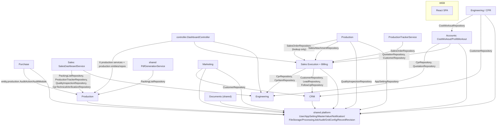

# Safe Modular Monolith Migration Plan — ERP Backend

**Repository:** `C:\Users\Mahes\Desktop\Sri\erp-react`
**Backend:** `erp-react/erp-backend` (Spring Boot 3 / Java 17 / Maven)
**Baseline audited:** `93a76c3da949f953c7273503d3a6383f31bbe82a` (branch `main`)
**Document type:** Audit + proposal. **No source file was created, modified, moved, renamed or deleted.**
**Date:** 2026-10-13

---

## 0. How to read this document

Every substantive claim is tagged:

| Tag | Meaning |
|---|---|
| **[VERIFIED]** | Read directly from the source at the audited commit. Paths are given so it can be re-checked. |
| **[INFERRED]** | A conclusion drawn from verified facts, with the reasoning shown. |
| **[PROPOSED]** | A recommendation for work that has **not** been implemented. Nothing in this document has been applied. |

**Constraint compliance.** This task is audit-only. No Java, SQL, JS, config or schema file was touched. The only artefact produced by this task is this Markdown report. No API route, DTO, auth rule, business rule, schema or deployment topology is changed or proposed to change *in this step*.

---

## 1. Current architecture and findings

### 1.1 Deployment units (verified)

| Unit | Evidence | Port |
|---|---|---|
| **One** Spring Boot backend artifact (single Maven project → one JAR) | [pom.xml](erp-react/erp-backend/pom.xml) | `8080`, context path `/v1` |
| The **same JAR** re-launched as an isolated CAD worker | [CadWorkerConfiguration.java](erp-react/erp-backend/src/main/java/com/vishatech/cadworker/CadWorkerConfiguration.java) — `WebApplicationType.NONE`, scan narrowed to `com.vishatech.erp.cad` + `com.vishatech.cadworker` | **no port** |
| React SPA (Vite) | [vite.config.js](erp-react/vite.config.js) | `5173` |
| **One** MySQL database `erp_db` | [application.properties](erp-react/erp-backend/src/main/resources/application.properties) | `3306` |

There is exactly **one** `@SpringBootApplication` that serves HTTP (`com.vishatech.erp.ErpApplication`). The CAD worker is a second *process* of the same artifact, not a second service — it shares the same schema (`@EntityScan("com.vishatech.erp.entity")`, `@EnableJpaRepositories("com.vishatech.erp.repository")`) and communicates only through the `cad_conversion_jobs` table. **[VERIFIED]**

### 1.2 Actual Java package structure

Root package `com.vishatech`. File counts per package **[VERIFIED]**:

| Package | .java files |
|---|---|
| `erp.dto` | 178 |
| `erp.entity` | 130 |
| `erp.repository` | 91 |
| `erp.service` | 77 |
| `erp.controller` | 57 |
| `erp.dto.production` | 40 |
| `erp.entity.production` | 33 |
| `erp.config` | 20 |
| `erp.repository.production` | 19 |
| `erp.controller.production` | 18 |
| `erp.service.production` | 15 |
| `erp.cad` | 13 |
| `erp.security` | 10 |
| `erp.util` | 6 |
| `erp.exception` | 6 |
| `com.vishatech.cadworker` | 6 |
| `erp.util.production` | 5 |
| `erp.config.production` | 2 |
| `erp.service.cad` | 1 |
| `erp` (`ErpApplication`) | 1 |

**The central architectural finding:** the arrangement is **package-by-layer** (`controller` / `service` / `repository` / `entity` / `dto`), not package-by-feature. Only **Production** and **CAD** have genuine feature sub-packages. Everything else — Purchase (10 controllers, 13 services), Sales (≈14 controllers, ≈20 services), CRM, Marketing, Finance — lives as flat files inside the layer packages and is separated only by class-name prefix and URL prefix. **[VERIFIED]**

### 1.3 The business modules as they actually exist

The module list is not invented here — it is corroborated by three independent artefacts in the repository:

1. `DocumentModuleScope` names the ERP areas explicitly: *CRM, Sales Execution, CPR, Purchase, Production, Marketing* (+ legacy *Finance* spellings). See [DocumentModuleScope.java](erp-react/erp-backend/src/main/java/com/vishatech/erp/service/DocumentModuleScope.java).
2. The integration test suite is already grouped by module under `src/test/java/com/vishatech/erp/api/`: `sales`, `purchase`, `production`, `marketing`, `finance`, `engineering`, `documents`, `inventory`, `users`, `administration`, `auth`.
3. The React client already ships feature folders `src/purchase/`, `src/production/`, and `src/pages/{crm,cpr,marketing,sales}` — i.e. the team's mental model is already package-by-feature on the frontend.

Consolidated module inventory **[VERIFIED entity/service ownership, INFERRED module grouping]**:

| Module (proposed name) | Core entities | Controllers / URL prefixes |
|---|---|---|
| **CRM** | `Lead`, `LeadStage`, `LeadStatus`, `Customer`, `CustomerContact`, `CustomerShippingAddress`, `Contact`, `FollowUp`, `Activity`, `Note`, `HistoryEntry`, `TimelineEntry` | `/leads`, `/customers`, `/contacts`, `/followups` |
| **Sales Execution** | `Quotation`, `QuotationItem`, `QuotationRemark`, `SalesContract`, `SalesOrder`, `SalesOrderItem`, `SalesOrderEAction`, `DeliveryChallan`, `ProformaInvoice`, `SalesSettings`, `SalesAttachment`, `SalesHistory`, `SalesTimeline`, `ProductionTracker` | `/quotations`, `/sales-contracts`, `/sales-orders`, `/delivery-challans`, `/proforma-invoices`, `/sales/dashboard`, `/sales/reports`, `/settings/sales`, `/production-trackers` |
| **Billing / Finance-Sales** | `Invoice`, `InvoiceItem`, `CreditNote`, `CreditNoteItem`, `PaymentReceipt` | `/invoices`, `/credit-notes`, `/payment-receipts` |
| **Accounts / Costing** | `CostWorkout`, `CostWorkoutItem`, `CostWorkoutCategory`, `CostWorkoutTimeline`, `ProfitWorkout`, `ProfitWorkoutItem`, `ProfitWorkoutCategory`, `ProfitWorkoutTimeline`, `CwMasterData`, `ExchangeRate` | `/cost-workouts`, `/profit-workouts`, `/exchange-rates` |
| **Engineering Design (CPR)** | `Cpr`, `CprItem`, `CprComment`, `CprHistory`, `CprTimeline`, `CprAttachment`, `CprApprovalStatus`, `CprStatus`, `CprTechnicalVerification`, `CprTechnicalVerificationDocument`, `PrReference` | `/cprs`, `/cpr-technical-verifications`, `/pr-references` |
| **Purchase** | 27 `Purchase*` entities (Rfq, Requisition, Order, Grn, Inspection, Invoice, AdjustmentNote, Vendor, Timeline, InventoryMovement, ManufacturingJob, Shipment, Quotation, Attachments) | `/api/purchase/**` (orders, requisitions, rfq, vendors, invoices, receiving, work-queue, dashboard, adjustment-notes, rfq-follow-ups) |
| **Production** | `entity.production` (33 types: `ProductionOrder`, `ProductionOrderItem`, `ProductionEntry`, `Model`, `Drawing`, `DrawingRevision`, `Casting`, `Dispatch`, `PackingList`, `Acknowledgement`, `TechnicalVerification`, `ProductionMachine`, `ProductionWorkCenter`, `ProductionStatusMaster`, `AuditLog`) | `/production-orders`, `/production-entries`, `/models`, `/drawings`, `/castings`, `/fabrications`, `/machine-shop`, `/assemblies`, `/integration`, `/dispatch`, `/packing`, `/technical-verifications`, `/acknowledgements`, `/audit`, `/production-kpi`, `/production/reports`, `/production/settings` |
| **CAD** | `erp/cad` engine abstraction + `cadworker` process | (none — no web surface) |
| **Marketing** | `MarketingLead`, `MarketingVisit`, `MarketingVisitActivity`, `MarketingTravelPlan`, `MarketingTravelPlanStop`, `MarketingFollowUp`, `MarketingExpense`, `MarketingExpenseTrip`, `MarketingExpenseAttachment`, `MarketingExpenseAuditLog`, `MarketingLocation`, `MarketingLocationTracking`, `MarketingRouteSnapshot`, `MarketingPlanChangeHistory`, `MarketingSettings`, `QuestionnaireForm`, `QFormAttachment`, `PlantContact`, `PlantOemDetail` | `/marketing/**`, `/settings/marketing` |
| **Documents (shared)** | `DocumentRepositoryEntry`, `DocumentVersion`, `DocumentAudit`, `DocumentVisibility` | `/documents`, `/files`, `/history`, `/record-revisions` |
| **Shared platform** | `AppSetting`, `MasterValue`, `GridConfig`, `Notification`, `User`, `UserRole`, `RefreshToken`, `Attachment`, `AttachmentStorageUsage`, `ProcessingJob`, `Product`, `City`, `Country`, `District`, `StateRegion`, `QualityInspection`, `PdfGeneration*` | `/settings`, `/masters`, `/notifications`, `/users`, `/auth`, `/products`, `/locations`, `/quality-inspections`, `/approvals` |

> Note on `ProductionTracker`: the *entity/repository/controller* sit in the **flat** `entity/`, `repository/`, `controller/` packages while `ProductionOrder` sits in `entity/production/`. This is a naming collision between the module "Production" (sub-packaged) and a sales-side "production tracker" record (flat). It is the single most confusing naming inconsistency found. **[VERIFIED]**

### 1.4 How boundaries are enforced today

They are **not** enforced. There is no `module-info.java`, no `package-info.java` anywhere in the backend, and no architecture test. **[VERIFIED]**
The only real boundary mechanisms today are:

* **URL prefixes** in `@RequestMapping` (e.g. everything under `/api/purchase/**`), which is a *web* boundary, not a compile-time one.
* **Java visibility** — a handful of package-private helper classes, but every service, repository and entity is `public`.
* **Convention** — class-name prefixes (`Purchase*`, `Marketing*`).

### 1.5 Baseline health (measured on the audited commit)

| Gate | Command | Result |
|---|---|---|
| Backend build + tests | `./mvnw -B -o verify` | see §12.1 (recorded below) |
| Frontend build | `npm run build` | **PASS**, exit 0, built in 6.97 s |
| Frontend lint | `npm run lint` | **FAIL**, exit 1, **863 problems (779 errors, 84 warnings)** |
| CI | [ci.yml](erp-react/.github/workflows/ci.yml) | runs frontend build + backend verify; **does not** run frontend lint or frontend tests |

Frontend lint is **red before any migration** and CI does not gate on it. Any migration plan that relies on "lint is green" as its safety net is unsound until this is acknowledged. **[VERIFIED]**

---

## 2. Module dependency map

### 2.1 Layer view

```
            ┌──────────────┐        ┌──────────────┐
 client ──► │  controller  │ ─────► │   service    │ ──► repository ──► entity ──► MySQL
            └──────────────┘        └──────────────┘
                    │                      │
                    │   8 controllers inject repositories/entities DIRECTLY (layer violations)
                    └──────────────────────┘
```

**Verified layer violations** — controllers that bypass the service layer and talk to a repository or entity directly:

| Controller | Direct repository/entity dependency |
|---|---|
| `controller/UserController.java` | `entity.User`, `entity.UserRole`, `repository.UserRepository` |
| `controller/ProductController.java` | `entity.Product`, `repository.ProductRepository` |
| `controller/RecordRevisionController.java` | `entity.RecordRevision`, `repository.RecordRevisionRepository` |
| `controller/QualityInspectionController.java` | `entity.QualityInspection` |
| `controller/MarketingVisitActivityController.java` | `entity.MarketingVisit`, `entity.MarketingVisitActivity` |
| `controller/QuestionnaireFormController.java` | `entity.QFormAttachment`, `repository.QFormAttachmentRepository` |
| `controller/FileController.java` | `entity.DocumentRepositoryEntry`, `repository.DocumentRepositoryEntryRepository`, `repository.DocumentVersionRepository` |
| `controller/ExpenseTripController.java` | `entity.MarketingExpenseAttachment`, `repository.MarketingExpenseAttachmentRepository` |

Additionally, **`dto` is imported by `repository`** (8 files), `security` (3 files) and `config`/`exception` — i.e. DTOs are not a controller-only concern. **[VERIFIED]**

### 2.2 Module dependency graph

`──►` = compile-time dependency (Java `import`). Derived from actual imports, not documentation.



### 2.3 Verified cross-module import edges

These are the concrete seams. Each row was read from the source file named.

#### (a) Production → Sales  **— the seam the task asks about (see §3)**

| File | Cross-module imports | What it does with them |
|---|---|---|
| [ProductionOrderService.java](erp-react/erp-backend/src/main/java/com/vishatech/erp/service/production/ProductionOrderService.java) | `entity.SalesOrder`, `repository.SalesOrderRepository` | `resolveCpo(idOrNumber)` → `findById`, `findBySoNo`; copies `soNo`/`id` into Production's own columns |
| [ProductionAttachmentService.java](erp-react/erp-backend/src/main/java/com/vishatech/erp/service/production/ProductionAttachmentService.java) | `entity.SalesAttachment`, `repository.SalesAttachmentRepository`, `service.FileStorageService` | attachment persistence |
| [ProductionTrackerService.java](erp-react/erp-backend/src/main/java/com/vishatech/erp/service/ProductionTrackerService.java) | `entity.SalesOrder`, `repository.SalesOrderRepository` | real `@ManyToOne` link |
| [ProductionKpiService.java](erp-react/erp-backend/src/main/java/com/vishatech/erp/service/production/ProductionKpiService.java) | `entity.QualityInspection`, `repository.QualityInspectionRepository` | KPI reads inspection results |
| [ProductionSettingsService.java](erp-react/erp-backend/src/main/java/com/vishatech/erp/service/production/ProductionSettingsService.java) | `entity.AppSetting`, `repository.AppSettingRepository` | settings (shared infra) |

#### (b) Sales / shared → Production

| File | Cross-module imports |
|---|---|
| [SalesDashboardService.java](erp-react/erp-backend/src/main/java/com/vishatech/erp/service/SalesDashboardService.java) | `repository.production.PackingListRepository`, `repository.ProductionTrackerRepository`, `repository.QualityInspectionRepository`, `repository.CprTechnicalVerificationRepository` |
| [PdfGenerationService.java](erp-react/erp-backend/src/main/java/com/vishatech/erp/service/PdfGenerationService.java) | `repository.production.PackingListRepository` + wildcard `entity.*`, `repository.*` |
| [DashboardController.java](erp-react/erp-backend/src/main/java/com/vishatech/erp/controller/DashboardController.java) | `service.production.{DispatchService, DrawingService, ModelService, PackingListService, ProductionOrderService, TechnicalVerificationService}`, `entity.production.{EntryStatus, ProductionType}`, `repository.production.ProductionEntryRepository`, `dto.production.*`, `repository.CustomerRepository`, `repository.FollowUpRepository`, `service.CprTechnicalVerificationService`, `service.DashboardService`, `service.QualityInspectionService` |

`DashboardController` is the **worst single coupling point** in the codebase: one controller importing services from three modules plus two repositories directly.

#### (c) Purchase → Production

| File | Imports |
|---|---|
| [PurchaseSupportService.java](erp-react/erp-backend/src/main/java/com/vishatech/erp/service/PurchaseSupportService.java) | `entity.production.AuditAction`, `entity.production.AuditModule` |

Purchase reuses Production's **audit enums** and writes into Production's audit tables. This is the only Purchase → Production edge. **[VERIFIED]**

#### (d) Sales ↔ Engineering ↔ Accounts loop

| File | Cross-module imports |
|---|---|
| [QuotationService.java](erp-react/erp-backend/src/main/java/com/vishatech/erp/service/QuotationService.java) | `entity.Cpr`, `entity.CprItem` (+ the whole Sales billing chain) |
| [CprService.java](erp-react/erp-backend/src/main/java/com/vishatech/erp/service/CprService.java) | `entity.Customer`, `entity.CostWorkout`, `entity.CostWorkoutCategory`, `repository.CostWorkoutRepository`, `repository.CustomerRepository` |
| [CprTechnicalVerificationService.java](erp-react/erp-backend/src/main/java/com/vishatech/erp/service/CprTechnicalVerificationService.java) | `entity.CostWorkout`, `repository.CostWorkoutRepository`, `repository.CustomerRepository`, `repository.CprItemRepository` |
| [CostWorkoutService.java](erp-react/erp-backend/src/main/java/com/vishatech/erp/service/CostWorkoutService.java) | `entity.Cpr`, `entity.CprStatus`, `entity.CprTimeline`, `repository.CprRepository`, `entity.CwMasterData`, `repository.CwMasterDataRepository` |
| [ProfitWorkoutService.java](erp-react/erp-backend/src/main/java/com/vishatech/erp/service/ProfitWorkoutService.java) | `entity.Quotation`, `repository.QuotationRepository`, `entity.Customer`, `repository.CustomerRepository`, `entity.CwMasterData` |
| [PrReferenceService.java](erp-react/erp-backend/src/main/java/com/vishatech/erp/service/PrReferenceService.java) | `entity.Cpr`, `repository.CprRepository` |

Sales → Engineering is **read/convert** (Quotation from CPR); Engineering → Accounts is **read** (CostWorkout from CPR); Accounts → Sales is **read** (ProfitWorkout from Quotation). It is a **cycle**: Sales → Engineering → Accounts → Sales. **[VERIFIED]** This cycle is the single biggest obstacle to a clean module split.

#### (e) Sales-internal "document chain" (mutual, high fan-out)

`QuotationService`, `SalesContractService`, `SalesOrderService`, `ProformaInvoiceService`, `DeliveryChallanService`, `InvoiceService`, `CreditNoteService`, `PaymentReceiptService` **each import most of the others' entities and repositories**, plus `SalesAttachment`, `SalesHistory`, `SalesTimeline`. Example: `QuotationService` imports 24 entities and 18 repositories; `SalesOrderService` imports 17 entities / 13 repositories; `SalesContractService` imports 17 / 12. **[VERIFIED]**

> Interpretation **[INFERRED]:** these eight classes are not eight modules — they are **one module (Sales Order-to-Cash)** whose transaction script is spread across eight services that walk each other's repositories. Any plan that treats them as separate modules will fail. They must be migrated as one unit.

#### (f) CRM as a shared "master" supplier

| Consumer | Import |
|---|---|
| `MarketingVisitService` | `entity.Customer`, `repository.CustomerRepository` |
| `CprService`, `CprTechnicalVerificationService`, `ProfitWorkoutService` | `repository.CustomerRepository` |
| `MasterValueService`, `LocationMasterService` | `CustomerRepository`, `LeadRepository`, `QuotationRepository`, `SalesOrderRepository`, `SalesContractRepository`, `DeliveryChallanRepository`, `InvoiceRepository`, `PaymentReceiptRepository`, `ProformaInvoiceRepository`, `CreditNoteRepository`, `CprItemRepository`, `CprRepository`, `CostWorkoutRepository`, `QualityInspectionRepository` |
| `ContactService` | `entity.Contact`, `entity.Customer`, `entity.Lead` (module-internal) |

`Customer`/`Lead` are treated by the rest of the system as **master data**, not as CRM-internal records. **[VERIFIED]**

#### (g) Shared infrastructure consumers (legitimate reuse)

| Shared capability | Evidence of reuse |
|---|---|
| Notifications (`entity.Notification`, `service.NotificationService`, `config.NotificationScheduler`) | `PurchaseInvoiceService`, `PurchaseOrderService`, `PurchaseRequisitionService`, `PurchaseNotificationPublisher`, `NotificationController` |
| File storage (`service.FileStorageService`, `AttachmentStorageService`, `config.UploadStorageConfig`, `UploadSizeGateFilter`) | `ExpenseTripController`, `QuestionnaireFormController`, `ExpenseTripService`, `production/ProductionAttachmentService`, `FileController` |
| Audit / revision (`entity.RecordRevision`, `entity.EditHistory`, `service.EditHistoryService`, `service.RecordRevisionService`) | consumed by `QuotationService`, `SalesOrderService`, `SalesContractService`, `CustomerService`, `CreditNoteService`, `DeliveryChallanService`, `InvoiceService`, `PaymentReceiptService`, `LeadService`, `FollowUpService`, `ProformaInvoiceService` |
| Async jobs (`entity.ProcessingJob`, `repository.ProcessingJobRepository`, `service.ProcessingJob{Service,Claimer,InputStore,Handler}`, `config.ProcessingJob{AsyncConfig,RecoveryJob}`) | `SalesContractController`, `SalesContractBulkExtractionService`, `SalesContractExtractionJobHandler` |
| Sales timeline/history (`SalesAttachment`, `SalesHistory`, `SalesTimeline` + repos) | the whole Sales chain **and** `AttachmentTransfer`, `production/ProductionAttachmentService` |
| Security / auth (`security/*`, `entity.User/UserRole/RefreshToken`) | everywhere |
| Documents (`Document*` entities + `DocumentModuleScope`) | `DocumentRepositoryController`, `FileController`, `DocumentBackfillService` (wildcard `entity.*`/`repository.*`) |
| Master data + settings (`MasterValue`, `AppSetting`, `GridConfig`, `Country/City/District/StateRegion`, `Product`) | everywhere |
| Metrics (`config.ErpMetrics`) | referenced from `config` |

### 2.4 Database-level coupling

One shared schema, one transaction manager. Cross-module **foreign keys / references** observed in the entities **[VERIFIED]**:

| Source | Target | Kind |
|---|---|---|
| `ProductionTracker` | `SalesOrder` | real JPA `@ManyToOne`, `sales_order_id` FK |
| `ProductionOrder` | Sales order | **denormalised strings only**: `sales_order_id VARCHAR(50)`, `sales_order_number VARCHAR(50)`, `customer`, `customer_code`, `product`, `product_code`, `quantity` — **no JPA association** |
| `Contact` | `Lead`, `Customer` | `@ManyToOne` with `ON DELETE SET NULL` semantics (`docs/contacts_migration.sql` referenced in the entity javadoc) |
| `SalesOrderEAction`, `SalesOrderItem` | `SalesOrder` | own aggregate |
| `Purchase*` entities | each other + `PurchaseGrp/Timeline` | own aggregate |
| `entity.production.*` | each other (`ProductionOrderItem`, `TimelineEvent`, `ApprovalHistory`, …) | own aggregate |
| `MarketingVisit` etc. | `Customer`, `User` | cross-module reference |

### 2.5 Legitimate shared infrastructure vs unnecessary coupling

| # | Item | Classification | Why |
|---|---|---|---|
| 1 | security/auth (`security`, `User`, `RefreshToken`) | **Legitimate shared** | Cross-cutting; every request needs it. |
| 2 | notifications | **Legitimate shared** | Generic delivery mechanism; no domain data. |
| 3 | file storage / upload | **Legitimate shared** | Infrastructure concern. |
| 4 | master data (`MasterValue`, `AppSetting`, `Country/City/District/StateRegion`, `Product`) | **Legitimate shared** | True reference data. |
| 5 | audit/revision (`EditHistory`, `RecordRevision`) | **Legitimate shared** | Generic mechanism, though currently only Sales uses it. |
| 6 | async job pipeline (`ProcessingJob*`) | **Legitimate shared** (under-used) | Generic worker queue; only Sales consumes it today. |
| 7 | documents repository (`Document*`) | **Legitimate shared** | Deliberately multi-module (see `DocumentModuleScope`). |
| 8 | metrics / grid config | **Legitimate shared** | Cross-cutting. |
| 9 | `SalesAttachment`/`SalesHistory`/`SalesTimeline` reused by Production and `AttachmentTransfer` | **Unnecessary coupling** | Sales-specific entities leaking into another module. Production should own `ProductionAttachment`; the timeline is a Sales audit log. |
| 10 | `entity.production.AuditAction`/`AuditModule` used by Purchase | **Unnecessary coupling** | Purchase writes Production's audit. The enum pair belongs in shared audit, not in `entity.production`. |
| 11 | `PdfGenerationService` → `repository.production.PackingListRepository` | **Unnecessary coupling** | A shared utility reaching into a feature repository. |
| 12 | `DashboardController` → 6 Production services + 2 repositories | **Unnecessary coupling** | Read-model aggregation implemented inside a web controller. |
| 13 | `MasterValueService` / `LocationMasterService` → 11+ Sales/CPR repositories | **Unnecessary coupling (but deliberate)** | "Is this master value in use?" checks reach across modules. Should become a per-module **usage-provider** contract instead of a hard-coded repository list. |
| 14 | `util/PurchaseNumbering.java`, `util/PurchaseTotals.java` in the generic `util` package | **Misplaced (minor)** | Purchase-specific helpers in shared util. |
| 15 | Wildcard imports `entity.*` / `repository.*` | **Coupling smell** | `DocumentBackfillService`, `ExpenseTripService`, `MarketingCalendarService`, `MarketingDashboardService`, `MarketingMapService`, `PdfGenerationService`, `PurchaseReceivingService`. A wildcard makes every cross-package edge invisible to code review and would defeat an ArchUnit rule that lists allowed targets. |
| 16 | Controllers → repository/entity (§2.1) | **Layer violation** | Bypasses the service layer; makes the module's public surface ambiguous. |

---

## 3. The Production → Sales dependency, explained

**Question:** what does Production actually need from Sales?

**[VERIFIED]** There are exactly **three** touch points and they need only four fields.

**1. Resolving a customer purchase order (CPO) to a production order — [ProductionOrderService.java](erp-react/erp-backend/src/main/java/com/vishatech/erp/service/production/ProductionOrderService.java)**

```java
import com.vishatech.erp.entity.SalesOrder;
import com.vishatech.erp.repository.SalesOrderRepository;
...
private SalesOrder resolveCpo(String cpoId, String cpoNumber) {
    SalesOrder byId = salesOrderRepository.findById(Long.valueOf(cpoId.trim())).orElse(null);
    ...
    SalesOrder byNo = salesOrderRepository.findBySoNo(cpoId.trim()).orElse(null);
    ...
    return salesOrderRepository.findBySoNo(cpoNumber.trim()).orElse(null);
}
```

Used in `create(...)` and `update(...)` to fill **its own** columns:

```java
order.setSalesOrderId(String.valueOf(cpo.getId()));
order.setSalesOrderNumber(cpo.getSoNo());
```

Production's fields actually consumed from `SalesOrder`: **`id`** and **`soNo`**. That is the whole contract.

**2. Does Production hold a real link to the sales order?** For `ProductionOrder` — **no.** `entity/production/ProductionOrder.java` stores `sales_order_id`, `sales_order_number`, `customer`, `customer_code`, `product`, `product_code`, `quantity` as **plain columns** (`@Column`, not `@ManyToOne`). It is already a *copy*, i.e. an anti-corruption boundary that exists today by accident. **[VERIFIED]**

For `ProductionTracker` (flat package) — **yes**: `@ManyToOne @JoinColumn(name = "sales_order_id") private SalesOrder salesOrder;` **[VERIFIED]**

**3. Reading sales attachments** — `ProductionAttachmentService` persists against `SalesAttachment`/`SalesAttachmentRepository`. This is *not* a data need from Sales; it is a **storage-location coincidence** (Production writes into the sales attachment table). **[INFERRED]**

**Conclusions:**

* Production needs from Sales exactly: **`SalesOrder.id`, `SalesOrder.soNo`** (to denormalise onto the production order), and **a place to store attachments**.
* There is **no Sales → Production compile dependency** at all. The direction is one-way at compile time. **[VERIFIED]**
* The Production → Sales edge is **already narrow enough to be replaced by one small interface** with two methods:
  ```java
  public interface SalesOrderLookupPort {            // [PROPOSED]
      Optional<SalesOrderRef> byId(Long id);         // returns id + soNo + customer + product
      Optional<SalesOrderRef> bySoNo(String soNo);
  }
  ```
  Production would never import `entity.SalesOrder` or `repository.SalesOrderRepository` again.
* `ProductionTracker`'s real `@ManyToOne` is a **harder** case: it is a genuine cross-module aggregate reference. Either it stays inside Sales (it is a Sales-side record — see §6) or it becomes a read-only projection.
* The **inbound** direction is the real coupling problem: `SalesDashboardService`, `DashboardController`, `PdfGenerationService` all reach *into* Production. Fixing Production's outward edge alone will not clean the graph.

---

## 4. Public interfaces vs internals

### 4.1 What should be public

Per module **[PROPOSED]**:

| Published surface | Contents |
|---|---|
| `…/api/` (or `…/facade/`) | The handful of interfaces other modules may call. These are **the entire public contract**. |
| HTTP controllers | Stay public because they are the web entry point — but only the framework should call them. |
| DTOs used in those interfaces | Public. |

### 4.2 What should stay internal

**[PROPOSED]** — package-private (or moved into an `internal/` sub-package with an ArchUnit rule forbidding outside access):

* **All `@Entity` classes** except the few explicitly exported (§4.3). JPA requires them accessible to the persistence provider, but nothing in another module should import them.
* **All repositories.** Currently the largest source of accidental coupling: 91 repositories are importable from anywhere, and roughly 40 cross-module repository imports exist (§2.3).
* **All `@Service` implementation classes.** Other modules should see the interface, not `QuotationServiceImpl`.
* **Timeline/history/attachment entities** (`SalesTimeline`, `SalesHistory`, `PurchaseTimeline`, `SalesAttachment`) — internal bookkeeping.
* **Internal helper classes**: `RevisionSupport`, `ProcessingJobClaimer`, `ProcessingJobInputStore`, `DocumentBackfillService`, `CadJobStore`, `GlbOutputValidator`, `OrderMapper`, `ProductionWorkflow`, `WorkflowValidator`.

### 4.3 Interfaces to introduce, per verified seam

**[PROPOSED]** — one small interface per real edge, no behaviour change:

| Interface | Replaces | Consumed by |
|---|---|---|
| `SalesOrderLookupPort` | `SalesOrderRepository` + `entity.SalesOrder` in Production | `production.ProductionOrderService` |
| `CustomerLookupPort` | `CustomerRepository` | Marketing, CPR, Accounts, Masters, Locations |
| `CprLookupPort` | `CprRepository` + `entity.Cpr/CprItem` | Sales (`QuotationService`), `PrReferenceService`, `MasterValueService` |
| `CostWorkoutLookupPort` | `CostWorkoutRepository` + `entity.CostWorkout*` | `CprService`, `CprTechnicalVerificationService` |
| `QuotationLookupPort` | `QuotationRepository` + `entity.Quotation` | `ProfitWorkoutService` |
| `QualityInspectionLookupPort` | `QualityInspectionRepository` | `ProductionKpiService`, `SalesDashboardService` |
| `ProductionReadModel` (query only) | 6 production services + `ProductionEntryRepository` in `DashboardController` | `DashboardController` |
| `PackingListLookupPort` | `PackingListRepository` in `PdfGenerationService`, `SalesDashboardService` | shared PDF, Sales dashboard |
| `MasterUsageProvider` (one impl per module) | the 11-repository lists in `MasterValueService`/`LocationMasterService` | Platform masters |
| `AuditTrailPort` | `entity.production.AuditAction/AuditModule` used by Purchase | Purchase |
| `AttachmentStorePort` | `SalesAttachmentRepository` used by Production/`AttachmentTransfer` | Production, Documents |

Each interface is a **mechanical extraction** (delegating to the existing repository). No SQL, no schema, no route, no DTO change.

---

## 5. Recommended target package structure

**[PROPOSED]** — package-by-feature, reached **incrementally**. The shape below matches the module list in §1.3 and mirrors what the frontend already does (`src/purchase/`, `src/production/`).

```
com.vishatech.erp
├── ErpApplication.java
├── shared/                                  # cross-cutting; may NOT depend on any feature module
│   ├── security/            (from com.vishatech.erp.security)
│   ├── config/              (from config/* except production)
│   ├── error/               (from exception/)
│   ├── util/                (from util/ minus purchase helpers)
│   ├── notification/        (Notification entity + service + scheduler)
│   ├── storage/             (FileStorageService, AttachmentStorageService, Attachment*)
│   ├── masters/             (MasterValue, AppSetting, GridConfig, Country/City/District/StateRegion, Product)
│   ├── documents/           (Document* entities/services/controller, DocumentModuleScope)
│   ├── jobs/                (ProcessingJob*)
│   ├── audit/               (EditHistory, RecordRevision, and a module-neutral AuditAction/AuditModule)
│   ├── identity/            (User, UserRole, RefreshToken, AuthService, RefreshTokenService)
│   └── pdf/                 (PdfGenerationService)
├── crm/          { Lead, Customer, Contact, FollowUp, Activity, Note, HistoryEntry, TimelineEntry }
├── sales/        { Quotation, SalesContract, SalesOrder, ProformaInvoice, DeliveryChallan,
│                   Invoice, CreditNote, PaymentReceipt, ProductionTracker, SalesSettings }
├── accounts/     { CostWorkout*, ProfitWorkout*, CwMasterData, ExchangeRate }
├── engineering/  { Cpr*, PrReference }
├── purchase/     { Purchase* }
├── production/   { entity.production/*, service.production/*, controller.production/*,
│                   dto.production/*, util.production/*, config.production/* }
├── marketing/    { Marketing*, QuestionnaireForm, QFormAttachment, PlantContact, PlantOemDetail }
├── cad/          (from erp/cad + erp/service/cad)
└── dashboard/    { read-model aggregation extracted from DashboardController }
```

Each feature module uses the **same internal shape**:

```
<module>/
├── api/            # public: controllers + the exported interfaces + exported DTOs
├── domain/         # services + entities + repositories (internal to the module)
└── internal/       # helpers, mappers, workflows — never referenced outside
```

**Important:** the target is a **destination, not a big-bang move**. §7 reaches it one module at a time; every intermediate state must build and pass tests. Modules may keep their current package for as long as necessary — the value comes from the *rules* (§6) plus the *interfaces* (§4.3), which can be introduced without moving a single file.

### 5.1 Why the frontend is the precedent

`src/purchase/` and `src/production/` already contain `api|services|pages|components|hooks|utils|routes|styles|constants|validation`. The backend adopting `api/domain/internal` is not a foreign idea — it is the same pattern the team already applies in the client. **[VERIFIED]**

---

## 6. Proposed module-boundary rules

**[PROPOSED]** — the rules an architecture test would enforce (§7). Written as "must", with the verified violation they would catch today.

| # | Rule | Catches today |
|---|---|---|
| R1 | A feature module may depend on `shared..` freely. | — |
| R2 | `shared..` must **not** depend on any feature module. | `shared/pdf/PdfGenerationService → production` |
| R3 | A feature module may reach another feature module **only** through its `api` package. | 40+ repository imports across modules |
| R4 | No class outside a module may import that module's `domain` (entity/repository/service-impl). | §2.3 in full |
| R5 | `production..` must not depend on `sales..` except `production → sales.api.SalesOrderLookupPort`. | `ProductionOrderService` |
| R6 | `sales..` must not depend on `production..` except `sales → production.api.ProductionReadModel`. | `SalesDashboardService`, `PdfGenerationService` |
| R7 | `purchase..` must not depend on `production..` except `purchase → shared.audit.api.AuditTrailPort`. | `PurchaseSupportService` |
| R8 | `purchase..` must not depend on `sales..` at all. | (already true today — a **regression guard**) |
| R9 | `marketing..` must not depend on `sales..`/`accounts..`/`engineering..`/`production..`; only `crm.api.CustomerLookupPort` + `shared..`. | wildcard imports in 4 Marketing services |
| R10 | `accounts..` ↔ `engineering..` must be acyclic: `accounts → engineering.api`, `engineering → accounts.api`, neither → other's `domain`. | the Sales→Eng→Accounts→Sales cycle (§2.3d) |
| R11 | `controller..` must not depend on `repository..`. | 8 controllers (§2.1) |
| R12 | `entity..` must not depend on `service..` or `controller..`. | (currently clean — guard) |
| R13 | No `import …entity.*;` / `import …repository.*;` wildcards. | 7 services (§2.5 #15) |
| R14 | A class may not be used in a cyclic package dependency at module granularity (allow the two intentional cycles explicitly). | — |
| R15 | `cadworker..` must not depend on any feature module except `cad..` + shared entities/repositories declared on `CadWorkerConfiguration`. | (currently compliant — guard) |

---

## 7. Architecture test plan (ArchUnit)

### 7.1 Tooling

**[PROPOSED]** Add ArchUnit as a **test-scope only** dependency (no runtime impact, no new port, no deployment change):

```xml
<!-- PROPOSED, test scope only — not applied -->
<dependency>
  <groupId>com.tngtech.archunit</groupId>
  <artifactId>archunit-junit5</artifactId>
  <version>1.3.0</version>
  <scope>test</scope>
</dependency>
```

ArchUnit is not currently present in [pom.xml](erp-react/erp-backend/pom.xml); the existing test stack is `spring-boot-starter-test`, `spring-security-test`, H2. **[VERIFIED]**

### 7.2 Two-phase enforcement (this is the key to "gradual")

1. **Phase A — freeze.** Write the rules against the *current* package names and wrap them in ArchUnit's `FreezingArchRule`, which stores the current violations in a text store and fails only when a **new** violation appears. This lets the rules land on day one without a single code change and without a red build.
2. **Phase B — thaw.** As each module is migrated (§8), remove its entry from the frozen store. When the store is empty for a rule, convert it to a plain (unfrozen) rule so it can never regress.

### 7.3 Concrete rules (real package names)

**[PROPOSED]** — `src/test/java/com/vishatech/erp/architecture/ModuleBoundaryTests.java`:

```java
@AnalyzeClasses(packages = "com.vishatech.erp")            // current root today
class ModuleBoundaryTests {

  // Today's reality: everything is flat, so rules use *class-name* predicates
  // until the package move happens.
  static final DescribedPredicate<JavaClass> PRODUCTION =
      simpleNameMatching("Production.*").or(simpleNameMatching(".*PackingList.*"))
        .or(resideInAPackage("..erp..production.."));

  @ArchTest static final ArchRule no_controller_to_repository = freeze(
      noClasses().that().resideInAPackage("..erp.controller..")
        .should().dependOnClassesThat().resideInAPackage("..erp.repository.."));

  @ArchTest static final ArchRule entities_do_not_depend_on_services = freeze(
      noClasses().that().resideInAPackage("..erp.entity..")
        .should().dependOnClassesThat().resideInAnyPackage("..erp.service..", "..erp.controller.."));

  @ArchTest static final ArchRule no_wildcard_package_imports = freeze(
      noClasses().should().importClassesFromAPackageWithWildcards());   // custom rule

  @ArchTest static final ArchRule sales_order_lookup_only_via_port = freeze(
      noClasses().that().resideInAPackage("..erp.service.production..")
        .should().dependOnClassesThat().haveFullyQualifiedName("com.vishatech.erp.repository.SalesOrderRepository"));

  @ArchTest static final ArchRule marketing_isolation = freeze(
      noClasses().that().resideInAPackage("..erp.service..")
        .and().haveSimpleNameStartingWith("Marketing")
        .should().dependOnClassesThat().resideInAnyPackage(
            "..erp.service.production..", "..erp.repository.production.."));

  @ArchTest static final ArchRule cadworker_stays_isolated = freeze(
      classes().that().resideInAPackage("com.vishatech.cadworker..")
        .should().onlyDependOnClassesThat().resideInAnyPackage(
            "com.vishatech.erp.cad..", "com.vishatech.erp.entity..",
            "com.vishatech.erp.repository..", "java..", "org.springframework..", "jakarta.."));
}
```

**After** the package migration the same rules are rewritten with package prefixes — no predicate gymnastics:

```java
@ArchTest static final ArchRule production_to_sales = freeze(
    noClasses().that().resideInAPackage("com.vishatech.erp.production..")
      .should().dependOnClassesThat().resideInAPackage("com.vishatech.erp.sales.domain.."));

@ArchTest static final ArchRule purchase_to_sales =   // un-frozen the day it lands
    noClasses().that().resideInAPackage("com.vishatech.erp.purchase..")
      .should().dependOnClassesThat().resideInAPackage("com.vishatech.erp.sales..");
```

### 7.4 Other checks to add alongside ArchUnit **[PROPOSED]**

* **`package-info.java`** per module root, documenting the published surface. There are **zero** package-info files today.
* **A "fitness" test asserting every controller's `@RequestMapping` prefix matches its module** — cheap, and it locks the URL-prefix boundary that Purchase already uses.
* **Cyclic-dependency report** (`slices().matching("com.vishatech.erp.(*)..").should().beFreeOfCycles()`) run in "report" mode initially to visualise the Sales→Eng→Accounts→Sales cycle.
* Wire ArchUnit tests into CI ([ci.yml](erp-react/.github/workflows/ci.yml) already runs `mvnw verify`, so new tests run automatically).

---

## 8. Phased migration roadmap

Ordering principle: **lowest blast radius and highest boundary value first**; the Sales chain last, and possibly never. Every phase is independently shippable.

### Phase 0 — Freeze the baseline (no code change)
* Confirm a clean tree and a known-good commit.
* Record the exact gate results as the reference (§12.1).
* Get backend `verify` green and **acknowledge the frontend lint debt** (863 problems) as a pre-existing condition, not a migration regression. Decide whether lint becomes a gate; until then, rely on `npm run build` + the backend test suite.
* **Exit criteria:** a repeatable "before" number for every gate.

### Phase 1 — Add the architecture tests in frozen mode (no production code change)
* Add `archunit-junit5` (test scope), write the rules from §7.3, wrap in `FreezingArchRule`, commit the violation store.
* **Exit criteria:** `./mvnw verify` still green; the frozen store lists today's violations; a deliberately planted new violation fails the build.

### Phase 2 — Kill the wildcard imports and the controller→repository edges (mechanical, no behaviour change)
* Replace `entity.*`/`repository.*` wildcards with explicit imports in the 7 services (§2.5 #15).
* Move the 8 controllers (§2.1) onto their existing services, or (where no service exists) note the gap. **Do not** invent new business logic; only delegate.
* **Exit criteria:** R11 and R13 un-frozen; verify green; module API tests green.

### Phase 3 — Introduce ports/façades for the real seams (no file moves)
* Add the interfaces from §4.3, each delegating to the current repository/service.
* Point the consumer at the interface, one seam at a time, in this order (verified the seams are independent):
  1. `SalesOrderLookupPort` ← `production.ProductionOrderService` (2 fields!)
  2. `AttachmentsPort` ← `production.ProductionAttachmentService`, `AttachmentTransfer`
  3. `QualityInspectionLookupPort` ← `production.ProductionKpiService`
  4. `ProductionReadModel` ← `DashboardController`
  5. `PackingListLookupPort` ← `PdfGenerationService`, `SalesDashboardService`
  6. `AuditTrailPort` ← `PurchaseSupportService` (moves `AuditAction`/`AuditModule` to shared)
  7. `CprLookupPort` / `CostWorkoutLookupPort` / `QuotationLookupPort` ← the Sales↔Eng↔Accounts loop
  8. `MasterUsageProvider` (one per module) ← `MasterValueService`, `LocationMasterService`
* **Exit criteria:** R5, R6, R7 un-frozen; verify green.

### Phase 4 — Extract shared infrastructure into `shared/`
* `security`, `exception`→`error`, `util`, `notification`, `storage`, `masters`, `documents`, `jobs`, `audit`, `identity`, `pdf`.
* Mechanical `git mv` + import rewrite. **No logic change.** R2 becomes enforceable.
* Move `util/PurchaseNumbering`, `util/PurchaseTotals` into `purchase/`.
* **Exit criteria:** R2 un-frozen; verify green; `shared` contains no feature-module imports.

### Phase 5 — Migrate the two ready modules
* **Production** (already feature-packaged — smallest move): `entity.production`→`production.domain`, `service.production`→`production.domain`, `controller.production`→`production.api`, `dto.production`→`production.api.dto`, `util.production`→`production.internal`, `config.production`→`production.internal`.
  Also resolve the `ProductionTracker` naming collision (§1.3).
* **Purchase** (own URL prefix, own entities, only 2 shared-audit dependencies): same treatment under `purchase/`.
* **Marketing** (own entities; fix the `Customer` reference to the CRM port).
* **Exit criteria:** R5, R6, R7, R9, R15 un-frozen; module-by-module API tests green.

### Phase 6 — Migrate CRM, Accounts, Engineering, Documents, CAD
* CRM first (it is the shared "master" supplier — its `CustomerLookupPort` is already in use from Phase 3).
* Accounts + Engineering **together**, because they are mutually dependent (§2.3d) — migrating one alone creates a temporary two-way `domain` dependency.
* Then Documents and CAD (`erp.cad` → `cad.domain`, `service.cad` → `cad.domain`).
* **Exit criteria:** R3, R4, R10 un-frozen.

### Phase 7 — Migrate the Sales / Order-to-Cash module (last, optional)
* The eight chained services (§2.3e) move **as one unit**, never individually.
* Recommended only after every other module is clean and the test suite covers the order-to-cash flows end-to-end.
* If the business never needs it, this phase can legitimately be **skipped** — Phase 3 already removed the dangerous couplings.

### Explicitly **not** recommended **[PROPOSED]**
* Splitting into microservices or additional backend ports.
* Rewriting services into a different paradigm (hexagonal/CQRS) wholesale.
* Replacing the shared `DashboardController` with a separate process.
* Any schema change, any API-route change, any auth change, any frontend change.

---

## 9. Files likely to be affected in each phase

| Phase | Files | Count (approx.) |
|---|---|---|
| 0 | none | 0 |
| 1 | `erp-backend/pom.xml` (test dep), new `src/test/java/com/vishatech/erp/architecture/ModuleBoundaryTests.java` + freeze store | 2–3 new |
| 2 | `service/DocumentBackfillService.java`, `service/ExpenseTripService.java`, `service/MarketingCalendarService.java`, `service/MarketingDashboardService.java`, `service/MarketingMapService.java`, `service/PdfGenerationService.java`, `service/PurchaseReceivingService.java`; `controller/{UserController, ProductController, RecordRevisionController, QualityInspectionController, MarketingVisitActivityController, QuestionnaireFormController, FileController, ExpenseTripController}.java` | ~15 |
| 3 | new `…/api` interfaces (~11); modified `service/production/{ProductionOrderService, ProductionAttachmentService, ProductionKpiService}.java`, `service/{ProductionTrackerService, SalesDashboardService, PdfGenerationService, PurchaseSupportService, QuotationService, CprService, CprTechnicalVerificationService, CostWorkoutService, ProfitWorkoutService, MasterValueService, LocationMasterService}.java`, `controller/DashboardController.java`, `service/AttachmentTransfer.java`, `entity/production/{AuditAction, AuditModule}.java` (relocated) | ~30 |
| 4 | `security/*` (10), `exception/*` (6) → `error`, `util/*` (6), `config/*` (20, minus production), `cadworker/*` (6, package refs only); plus **every file that imports them** (auth services, all services using `Notification`/`FileStorage`/`AppSetting`/`Document*`/`ProcessingJob`) | ~150–250 (import-only) |
| 5 | Production (~140 files: 33 entity + 19 repo + 15 service + 18 controller + 40 dto + 5 util + 2 config), Purchase (~60: 10 controller + 13 service + 27 entity + ~20 repo), Marketing (~45) | ~245 |
| 6 | CRM (~25), Accounts (~20), Engineering (~20), Documents (~12), CAD (~14) | ~91 |
| 7 | Sales chain: ~14 controllers, ~20 services, ~35 entities, ~30 repositories, ~60 DTOs | ~160 |

> Phase 4 and Phase 7 file counts are dominated by **import-line rewrites only**. Phases 2 and 3 are the only phases that touch executable code, and even there the transformation is extract-delegate.

---

## 10. Regression testing checklist

### 10.1 Before every phase

| # | Check | Command |
|---|---|---|
| B1 | Clean tree, known commit | `git status --porcelain`, `git rev-parse HEAD` |
| B2 | Backend build + full test suite | `cd erp-backend && ./mvnw -B -o verify` |
| B3 | Frontend build | `cd erp-react && npm run build` |
| B4 | Runtime smoke | MySQL up, backend `{"status":"UP"}` on 8080, frontend HTTP 200 on 5173 |
| B5 | Record the numbers from B2–B4 as the phase baseline | — |

### 10.2 After every phase

| # | Check | Why |
|---|---|---|
| A1 | `./mvnw -B -o verify` green, **same test count** as B2 | The existing suite is the primary safety net. |
| A2 | Architecture tests green (frozen store unchanged except intentional un-freezes) | Boundary did not regress. |
| A3 | `npm run build` green | Frontend untouched, but the API contract must still compile against it. |
| A4 | `npm run lint` — compare against the baseline 863 problems, **do not expect green** | Any *increase* is a regression; the existing debt is not this task's to fix. |
| A5 | Contract/route assertions: every `@RequestMapping` prefix unchanged | Rule 3 — no API route may change. |
| A6 | DTO shape unchanged: POST/PUT payloads and response JSON byte-identical on the smoke flows | Rule 3 — no DTO change. |
| A7 | Auth unchanged: sign-in → token → protected endpoint → refresh | Rule 3 — no auth change. |
| A8 | `mysqldump --no-data` (schema snapshot) diff vs baseline = empty | Rule 3 — no schema change. |

### 10.3 Module acceptance tests already present (use them — do not write new ones unless needed)

The suite already maps onto the modules **[VERIFIED]**, which makes per-module acceptance cheap:

| Module | Existing test classes |
|---|---|
| Sales | `api/sales/SalesApiTest`, `security/{SalesExecApiTest, SalesDashboardApiTest, SalesReportsApiTest, SalesSettingsApiTest}`, `service/{QuotationPoStatusLinkageTests, SalesDocumentNumberSequenceTests, SalesOrderOptionsPagingTests}` |
| Purchase | `api/purchase/PurchaseApiTest`, `purchase/{PurchaseDocumentAuditIntegrationTests, PurchaseReceivingPagingIntegrationTests, PurchaseTechnicalReviewQueueIntegrationTests, PurchaseWorkQueueIntegrationTests}` |
| Production | `api/production/ProductionApiTest`, `production/ProductionKpiAggregationIntegrationTests`, `service/production/{ProductionOrderPagingTests, Drawing2DFormatSupportTests}` |
| Marketing | `api/marketing/MarketingApiTest`, `security/{MarketingSecurityTests, MarketingSettingsApiTest, MarketingActivityContractTests}` |
| Finance / Accounts | `api/finance/FinanceApiTest`, `security/CostWorkoutProfitWorkoutFlowApiTest`, `service/{CostWorkoutProfitWorkoutConversionTests, MasterValueCacheTests, MasterValueCacheDisabledTests}` |
| Engineering / CPR | `api/engineering/EngineeringApiTest`, `security/CprApiTest`, `service/{CprItemConversionTests, CprTechnicalVerificationStatusTests}` |
| CRM | `security/{CrmApiTest, ContactsApiTest}` |
| Documents | `api/documents/DocumentsApiTest`, `security/{DocumentsApiTest, DocumentReferenceApiTest}`, `service/DocumentMirrorPolicyTests` |
| Inventory | `api/inventory/InventoryApiTest` |
| Platform / users / auth | `api/{users,administration,auth}/*ApiTest`, `security/{JwtSecurityTests, AuthSecurityTests, AuthorizationSecurityTests, ExpiredJwtSecurityTests, RateLimitTests, RefreshTokenSecurityTests, RefreshTokenCleanupTests, CorsSecurityTests, FileSecurityTests, FileStorageSecurityTests, InputValidationSecurityTests}`, `ActuatorSecurityTests`, `config/*` |
| Performance (guard the DB access paths) | `performance/{ReadPathQueryCountTests, SalesDashboardAggregationTests, ScalabilityMeasurementTests}` |
| CAD worker isolation | `cadworker/CadWorkerSafetyTests`, `CadMissingEngineStartupTests` |

**Critical regression risks to watch per phase**

| Phase | Highest-risk regression |
|---|---|
| 2 | A controller that was doing work inline (not delegating to a service) — behaviour must be *moved*, not rewritten. |
| 3 | Lazy-loading/JPA semantics: `SalesOrderRepository.findById` inside a transaction behaves differently from a port that hides the entity. Watch `LazyInitializationException` and `performance/ReadPathQueryCountTests`. |
| 4 | Import-only, but the CAD worker's `@EntityScan`/`@EnableJpaRepositories`/`scanBasePackages` strings in `CadWorkerConfiguration` are **literal package names** — if `entity`/`repository` move, the worker silently loses its beans. `CadWorkerSafetyTests` + `CadMissingEngineStartupTests` must gate this. |
| 5 | Production's `@EntityScan`-visible packages and the `/production/**` routes; Purchase's `/api/purchase/**` routes. |
| 6 | The Sales↔Engineering↔Accounts cycle: splitting it incorrectly produces a compile-time deadlock or a two-way `domain` dependency. |
| 7 | The eight-service order-to-cash chain; `SalesDocumentNumberSequenceTests` and `QuotationPoStatusLinkageTests` are the key guards. |

---

## 11. Prioritisation by risk and benefit

| Rank | Change | Risk | Benefit | Verdict |
|---|---|---|---|---|
| 1 | Phase 1 — froze ArchUnit rules | Very low (test-only) | High — stops *new* coupling immediately, zero production risk | **Do first** |
| 2 | Phase 2 — wildcard imports + controller→repo | Low (mechanical) | Medium — makes one real rule enforceable; improves readability | **Do** |
| 3 | Phase 3 — ports/façades for the real seams | Low–medium (touches live code) | **Highest** — kills every dangerous cross-module edge without moving a file | **Do — the core of the plan** |
| 4 | Phase 4 — `shared/` extraction | Medium (huge import churn, CAD worker strings) | High — enables R2, clarifies the platform layer | **Do, carefully** |
| 5 | Phase 5 — Production / Purchase / Marketing packages | Medium | High — produces the first three genuine feature modules | **Do, module-by-module** |
| 6 | Phase 6 — CRM/Accounts/Engineering/Documents/CAD | Medium–high (the cycle) | Medium | **Do last of the migrations** |
| 7 | Phase 7 — Sales chain packages | High | Moderate (already isolated by Phase 3) | **Optional** |
| — | Microservices / new ports / Nginx / schema change / DTO change / route change | High | Low | **Explicitly not recommended** |

**Do not** recommend: a rewrite of the services, a new framework, a database split, per-module deployments, or any change that alters an API contract.

---

## 12. Risks, assumptions, and unresolved questions

### 12.1 Baseline evidence recorded for this report

| Gate | Command | Result (this session, commit `93a76c3`) |
|---|---|---|
| Backend build + tests | `cd erp-backend && ./mvnw -B -o verify` | **PASS** — exit 0, `BUILD SUCCESS`, **476 tests, 0 failures, 0 errors**, 3:35 min |
| Frontend build | `npm run build` | **PASS**, exit 0, 6.97 s |
| Frontend lint | `npm run lint` | **FAIL**, exit 1, 863 problems (779 errors, 84 warnings) |
| Git | `git status --porcelain` | No tracked file modified/added/deleted. `93a76c3`. Untracked: `?? ERP_ARCHITECTURE_CLASSIFICATION.md` (pre-existing), `?? MODULAR_MONOLITH_MIGRATION_PLAN.md` (this report) |

### 12.2 Risks

| # | Risk | Severity | Mitigation |
|---|---|---|---|
| 1 | **Frontend lint is already red (863 problems)** and CI does not gate on it — a migration could be blamed for pre-existing debt | High (perception + signal loss) | Record the baseline number; compare only deltas; do not attempt to fix lint as part of migration |
| 2 | **CAD worker package strings** (`@EntityScan`, `@EnableJpaRepositories`, `scanBasePackages` literals in `CadWorkerConfiguration`) break silently if `entity`/`repository` move | High | Gate Phase 4+ with `CadWorkerSafetyTests`, `CadMissingEngineStartupTests`, and a manual worker smoke run |
| 3 | **Sales↔Engineering↔Accounts cycle** — splitting naively creates a two-way domain dependency | High | Migrate Accounts and Engineering together; use ports |
| 4 | **The eight-service Sales chain** is one logical module; treating the services as separate modules will fail | High | Keep them as one migration unit (Phase 7) or skip Phase 7 |
| 5 | **`Customer`/`Lead` are de-facto shared masters**, not CRM-internal | Medium | Introduce `CustomerLookupPort` in Phase 3 before any CRM move |
| 6 | **`ProductionTracker` name collision** (flat vs `production` package) | Medium | Resolve explicitly in Phase 5; keep the URL `/production-trackers` unchanged |
| 7 | **JPA lazy-loading semantics change** when a repository call becomes a port call | Medium | Run `performance/ReadPathQueryCountTests` + `SalesDashboardAggregationTests` after every Phase-3 seam |
| 8 | **Package moves hide in `@ComponentScan`/`@EntityScan`/`@EnableJpaRepositories`/`@ConfigurationProperties` strings and `application.properties`** | Medium | Grep every literal package name before each move; the app fails to start with missing beans if missed |
| 9 | **The `contacts` table / `ddl-auto=validate` mismatch** — `entity.Contact` maps a `contacts` table; the checked-in schema has been reported absent | Medium (pre-existing) | Verify the live schema before Phase 0 completes; unrelated to migration but it is a boot risk |
| 10 | Import-churn phases touch hundreds of files, making review hard | Low–medium | One phase per commit, `git mv` where possible, no logic edits mixed with moves |

### 12.3 Assumptions

| # | Assumption | Status |
|---|---|---|
| 1 | The module grouping in §1.3 reflects how the team talks about the system | **[INFERRED]** from `DocumentModuleScope` javadoc, the test package names, and the frontend folder names |
| 2 | Existing tests are a sufficient safety net for behaviour preservation | **[INFERRED]** — 77 test classes / ~476 tests, including API tests per module; but E2E coverage of full workflows is unverified (§12.4) |
| 3 | No other process is concurrently editing the backend | **[VERIFIED]** clean tree at audit time |
| 4 | Phase 3 ports can delegate to the existing repositories without changing transaction boundaries | **[PROPOSED]** — must be validated by `performance/ReadPathQueryCountTests` |
| 5 | Nothing in the migration requires a schema or API change | **[VERIFIED by rule 3 of the task]**, and the plan is built to preserve that |

### 12.4 Unresolved questions / could not be verified

| # | Open item | Why it matters |
|---|---|---|
| 1 | **Live `erp_db` schema** — whether the `contacts` table exists | If `entity.Contact` maps a missing table, the app cannot boot under `ddl-auto=validate`. No MySQL client or driver was available to inspect it. |
| 2 | **End-to-end workflow coverage** — are the full order-to-cash, procure-to-pay and production flows exercised by any test? | Phase 3 and Phase 7 depend on it. Only per-module API tests were observed; no E2E suite was found. |
| 3 | **Whether the 476 tests all pass right now** | **Resolved:** yes — 476/476 passed on `93a76c3` this session (§12.1). |
| 4 | **CAD worker liveness in the deployed environment** | `CadWorkerSafetyTests` exists but the running worker was not verified. |
| 5 | **Is `GridConfig`, `ApprovalSummary`, `Product`, `QualityInspection` in `shared` or in their own modules?** | Currently single-controller/single-service each; grouping is a judgement call. |
| 6 | **Do any of the 178 DTOs contain cross-module fields** (a Sales DTO carrying a production status)? | Not exhaustively inspected; would affect Phase 5/7 packaging. |
| 7 | **Team appetite for the migration timeline** | Determines how far through Phase 5–7 to go. |

---

## 13. Summary

**Current state [VERIFIED].** The ERP backend is a **modular monolith in intent, layered monolith in structure**: one Maven artifact, one JAR, one Spring context serving `/v1` on 8080, plus one optional port-less CAD worker process from the same artifact, one shared MySQL schema. Business modules exist as *conventions* (name prefixes, URL prefixes, and three feature sub-packages for Production/CAD) but not as enforced boundaries — there is no `package-info.java`, no `module-info.java`, and no architecture test. `DashboardController`, `SalesDashboardService`, `PdfGenerationService`, `ProductionOrderService` and `MasterValueService`/`LocationMasterService` are the concrete coupling hotspots.

**The good news [VERIFIED].** The dangerous seams are already narrow. Production needs from Sales exactly `SalesOrder.id` and `SalesOrder.soNo` — two fields — and `ProductionOrder` already stores them as plain denormalised columns with no JPA relationship. Purchase has **zero** Sales dependency. The only cross-module cycle is Sales→Engineering→Accounts→Sales. This means the highest-value work is **introducing small ports/façades, not moving packages**.

**The plan [PROPOSED].** Eight phases: freeze the baseline → land ArchUnit in `FreezingArchRule` mode (zero production risk, stops new coupling immediately) → remove wildcard imports and controller→repository edges → introduce ~11 small port interfaces at the verified seams → extract `shared/` → migrate Production, Purchase and Marketing to real feature packages → migrate CRM/Accounts/Engineering/Documents/CAD → optionally migrate the Sales order-to-cash chain as a single unit. No new ports, no Nginx, no microservices, no schema/route/DTO/auth change, no frontend change, and no rewrite of any service.

**Bottom line.** Stop the bleeding first (Phase 1), fix the real edges second (Phase 3), move files last. Phase 3 delivers most of the architectural benefit with almost no risk; Phase 7 is optional and can be skipped without leaving the system unsafe.

---

## 14. Confirmation of no source changes

**No source files were modified, created, moved, renamed or deleted by this task.**

* The only file added is this report: `MODULAR_MONOLITH_MIGRATION_PLAN.md`.
* `git status --porcelain` before and after this task shows the same state: the pre-existing untracked report from the previous audit plus this new report. No `M`, `D`, `R`, or `A` entries were introduced.
* No change was made to `erp-backend/**` (Java, `pom.xml`, `application.properties`, schema files), nor to any React/Vite file.
* No API route, DTO, authentication rule, business rule, database schema, or deployment configuration was changed.
* Everything labelled **[PROPOSED]** in this document is a recommendation and has **not** been implemented.
